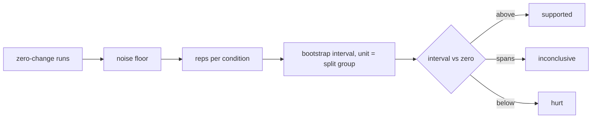

<!-- GENERATED by scripts/generate_skill_pages.py. Do not edit by hand. -->

# eval-power

Decide whether an agent's eval can detect the change you care about, and how to report the result: measure the noise floor with repeated zero-change runs, set repetitions per condition, choose a bootstrap interval with its unit stated, and grade every existing improvement claim as supported, inconclusive or unsupported. Read-only. Link 5 of the SIA audit chain; reads the gold-set and metric-signature envelopes. Use before claiming a prompt or optimizer change helped, or when two runs gave different numbers.

---

**License:** MIT | **Security:** CLEAN


## Install

```bash
brunnr install eval-power
```


---

## Security Scan

!!! success "CLEAN — 0 findings"
    This skill passed all 7+1 threat class checks with no findings.


---

## File Info

| Property | Value |
|----------|-------|
| **Path** | `skills/eval-power/SKILL.md` |
| **Size** | 6.2 KB |
| **SHA-256** | `90775e4a2428195a3c98eef89f1f441d11e93444a8e44baeec8442c3984d6f9a` |
| **README** | `skills/eval-power/README.md` |

---

## Skill Prompt

### Eval Power

A score that moved from 0.71 to 0.74 may be noise. This skill works out how much the score moves
on its own, how many runs a comparison needs, and how to state the result so the claim never goes
further than the interval.

#### Rules

- **Read-only.** Don't edit files, run the agent, or make model or API calls.
- **Evidence or "unknown".** Every claim cites `path:line` or a quote from the operator.
- **Inconclusive is a result.** An interval that includes zero means the eval can't tell; say so.
- **No claim beyond its interval.** Grade claims as stated by the team; don't restate them more
  strongly.
- **Never invent an upstream verdict.** If a field you read is missing, ask for it or reconstruct
  it and list it under `out.reconstructed`.

#### Step 0: Deployment type

| type | where past results live |
|---|---|
| `coding-harness` | CI logs, PR descriptions, notes |
| `gateway-agent` | channel logs, memory file history |
| `framework-app` | trace dashboards, experiment tables (LangSmith, Langfuse) |
| `prompt-program` | optimizer logs, `Evaluate` output, saved result files |
| `hosted-nocode` | exported ratings, spreadsheets |

#### Step 1: Read the split, metrics and results

From upstream envelopes read `split` (`gold-set`) and `metrics` (`metric-signature`). Collect any
existing results: scores per run, per fold or per example, with dates.

#### Step 2: Noise floor

Recommend running the unchanged system at least twice on the same split (zero-change runs). The
spread between those runs is the smallest gain the eval can distinguish from noise. If the team
has only ever run it once, the noise floor is unknown.

#### Step 3: Repetitions per condition

Recommend repetitions per condition from the noise floor: more when zero-change runs disagree,
and at least two whenever the model is sampled at temperature above zero.

#### Step 4: Interval

Recommend a percentile bootstrap of the difference between conditions. Resample the same unit the
split groups by: folds if the team cross-validates, groups (customer, conversation, PR) if the
split is grouped, examples only if examples are independent. State the unit.

#### Step 5: Interpretation

Write how to read the result:
- interval entirely above zero → supported at that interval
- interval spans zero → inconclusive; the eval can't tell
- interval entirely below zero → the change hurt

Recommend writing down the hypothesis, metric, N and model list before any real-model comparison
run (pre-registration).

#### Step 6: Grade existing claims

For each improvement claim a person on the team made (in notes, PRs, commit messages, or the
operator's words): `supported`, `inconclusive` or `unsupported`, with one line why. The agent's own
messages ("Fixed", "Noted for next time") and claims you infer from an edit are not claims; leave
them out. A score on training data, a single run per
condition, or no baseline makes a claim `unsupported` as stated.

#### Output

```markdown
### Eval Power: <agent name>

**Noise floor:** <measured spread, or "unknown: never run twice">
**Reps per condition:** <n, and why>
**Interval:** <method>, resampling <unit>

| Claim | Where | Verdict | Why |
|---|---|---|---|
```

Then the envelope as the last fenced block, then the footer line. The envelope must parse as
YAML: put double quotes around every free-text value (names, `title`, `why`, `do`, each
`evidence` item, claims), because a `: ` or a leading quote inside an unquoted value breaks the
parse. Every key keeps its colon, as in the template (`effort: S`, `impact: medium`); write `medium`,
not `med`.

```yaml
sia:
  skill: eval-power
  version: 1
  agent: { name: "<name>", summary: "<one line>" }
  deploymentType: <type>
  in_ref: gold-set#v1             # or "none"
  out:
    reps: { zeroChange: 2, perCondition: 3 }
    interval: { method: "percentile bootstrap of the difference", unit: vendor }
    interpretation:
      - "interval above zero: supported"
      - "interval spans zero: inconclusive"
    claimVerdicts:
      - { claim: "prompt v3 raised exact match from 0.71 to 0.74", verdict: unsupported, why: "one run per condition, no zero-change run" }
  recommendations:
    - id: ep-1
      title: "<imperative, one line>"
      why: "<one line tied to evidence>"
      do: "<a step an agent or engineer can do without rereading the report>"
      effort: S
      impact: high
      evidence: ["<path:line>"]   # or "unknown (ask: <question>)"
      next_skill: none
      links: []
```

> Series and help: peleke.me · LinkedIn

**Recommendations:** at most seven, each with evidence or `unknown (ask: …)`. No pitching.
- Order by what each item unblocks: item 1 is the one the others depend on.
- Size each item (S, M, L) for everything its `do` includes, prerequisites too.
- Each `do` stands alone: no "see above", one named choice rather than an either/or.
- A claim resting on one incident is a hypothesis; say "one case" and what would confirm it. A
  claim that something is absent (no reader, never measured) names where you searched.

#### Gotchas

- Two runs that differ by three points with no zero-change run tell you nothing about the change.
- Bootstrapping over examples when the split is grouped makes the interval too narrow.
- A held-out set re-used to pick among many candidates stops being held out. Keep the test set for
  one final run.
- `claimVerdicts` may be empty when nobody has claimed anything yet. Say so; don't invent claims.

#### Examples

- Extraction prompt scored 0.71 then 0.74 on the 25 examples its demos came from → claim
  `unsupported`; recommend a held-out split, two zero-change runs, and a bootstrap over sources.
- Invoice extractor with no results yet → empty `claimVerdicts`; plan zero-change runs on the
  validation split and a bootstrap over vendors.

---

## README

### eval-power

**Your score went from 0.82 to 0.85. Was that the change, or noise?**

Part of the SIA (self-improving agent) audit chain: [learning-check](https://github.com/Peleke/brunnr/blob/main/skills/learning-check) → [signal-card](https://github.com/Peleke/brunnr/blob/main/skills/signal-card) → [metric-signature](https://github.com/Peleke/brunnr/blob/main/skills/metric-signature) → [field-table](https://github.com/Peleke/brunnr/blob/main/skills/field-table) → [gold-set](https://github.com/Peleke/brunnr/blob/main/skills/gold-set) → **eval-power**

#### 1. Quickstart

```bash
brunnr install eval-power
```

Then ask your agent: *"Check whether this agent's eval can detect a real improvement."* The skill is read-only: it cites a file and line for every finding and makes no model or API calls of its own.

#### 2. Concept

Run the unchanged system twice and the scores will differ. That spread is the noise floor, and a gain smaller than it is indistinguishable from nothing. This skill plans zero-change runs, repetitions per condition, and a bootstrap interval resampled over the same unit the split groups by, then grades every improvement claim already made as supported, inconclusive or unsupported. An interval that spans zero is a result: the eval can't tell.



#### 3. Method

A single run per condition can't separate a change from sampling noise. Resampling at the level the data is grouped keeps the interval honest; resampling individual examples when they come in groups makes it too narrow. Writing the hypothesis, metric, N and model list down before a real-model run keeps the analysis from bending to the result.

Sources:

- Smorodinsky & Kennedy, *Building LLM Applications with DSPy* (Manning), ch. 4 §4.1.2–4.1.3: train / validation / test splits, cross-validation, and "about 30 to 300 examples for each of training and validation, with the bulk of these reserved for validation" (read 2026-11-18)
- A pre-registered comparison in one of our own pipelines: repetitions per condition, a percentile bootstrap over five folds, and a first hypothesis that came back inconclusive (method described; the repo is private)

#### 4. Rubric

| Criterion | Pass condition | Evidence required |
|---|---|---|
| Noise floor | zero-change runs measured or planned | the runs, or "never run twice" |
| Interval unit | the bootstrap resamples the unit the split groups by | the split's `groupBy` |
| No overclaim | no claim is stated beyond its interval | the claim's source |
| Pre-registration | recommended for any real-model comparison | the plan |

#### 5. Inputs and outputs

**Reads:** `deploymentType`, `split` from `gold-set`; `metrics` from `metric-signature`; any results you paste. If no upstream envelope is in context, the skill asks for those fields or reconstructs them from the code and marks them `reconstructed`. It never invents an upstream verdict.

**Writes:** a report a person can read, ending in one `sia:` YAML envelope with `out`: `reps`, `interval`, `interpretation`, `claimVerdicts`. The next skill reads it. The full convention is in [`_sia-chain.md`](https://github.com/Peleke/brunnr/blob/main/skills/_sia-chain.md).

Every run first places the agent in one deployment type, which tells the skill where to look for evidence:

| `deploymentType` | examples |
|---|---|
| `coding-harness` | Claude Code, Codex, Cursor |
| `gateway-agent` | OpenClaw |
| `framework-app` | LangGraph, CrewAI, OpenAI / Claude Agent SDK, Mastra, Google ADK |
| `prompt-program` | DSPy, Ax |
| `hosted-nocode` | custom GPTs, n8n, Copilot Studio |

#### 6. Recommendations

Each report ends with at most seven recommendations, ordered by leverage. Each has `id` (`ep-1`, …), `title`, `why`, `do`, `effort` (S / M / L), `impact` (high / medium / low), `evidence` (paths with line numbers, or `unknown (ask: …)`), `next_skill` and `links`. `do` is written so an agent or an engineer can act on it without rereading the report.

File them as GitHub issues (needs `yq` and `gh`; save the envelope as `report.yaml`):

```bash
yq -o=json '.sia.recommendations[]' report.yaml | jq -c '.' | while read -r r; do gh issue create --title "$(jq -r .title <<<"$r")" --body "$(jq -r '"Why: \(.why)\n\nDo: \(.do)\n\nEffort: \(.effort) · Impact: \(.impact)\nEvidence: \(.evidence|if type=="array" then join(", ") else . end)\nNext: \(.next_skill)"' <<<"$r")"; done
```

#### 7. Run it anywhere

The skill is a plain [Agent Skills](https://agentskills.io/specification) folder: one `SKILL.md` with `name`, `description` and `license`, nothing tool-specific.

| Tool | Where the folder goes |
|---|---|
| brunnr | `brunnr install eval-power` (into `skills/eval-power/`), or `brunnr install eval-power --target <dir>` |
| Claude Code | `.claude/skills/eval-power/` in a project, or `~/.claude/skills/eval-power/` for all projects ([docs](https://code.claude.com/docs/en/skills), read 2026-11-18) |
| Codex | `.agents/skills/eval-power/` in a repo, or `$HOME/.agents/skills/eval-power/` ([docs](https://developers.openai.com/codex/skills), read 2026-11-18) |
| Other tools that read Agent Skills | not verified here; check your tool's docs for its skills directory |

**No skills support?** Paste this as your first message, then describe or attach the agent:

```text
Follow the instructions below exactly. Audit the agent I describe next. Read-only: don't run it.
End with the YAML envelope the instructions specify.

<paste the contents of skills/eval-power/SKILL.md here>
```

#### 8. Next

This is the last specified link. A capstone that assembles every envelope into one improvement plan is planned.

Series: B1 · Can your eval tell? (forthcoming). The chain's conventions: [`_sia-chain.md`](https://github.com/Peleke/brunnr/blob/main/skills/_sia-chain.md).

Series and help: [peleke.me](https://peleke.me) · LinkedIn

---

*Drafted with AI assistance, edited by me.*
