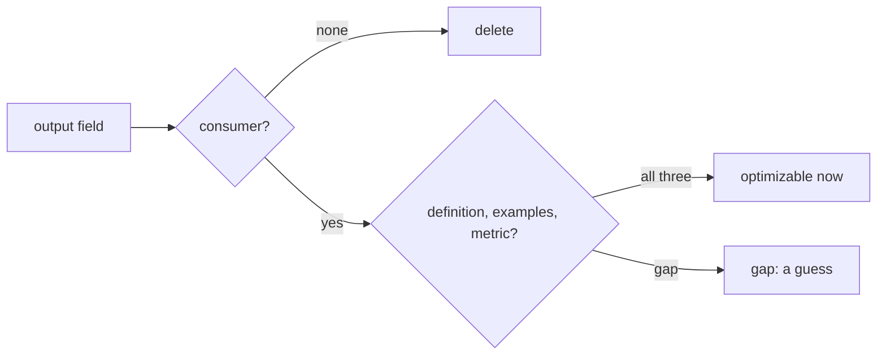

<!-- GENERATED by scripts/generate_skill_pages.py. Do not edit by hand. -->

# field-table

Before any optimizer, list every output an agent produces and fill four columns per output: consumer (what reads it), definition (written down where the model and the code both use it), labeled examples, and metric. Read-only. Flags outputs with no consumer for deletion and marks every gap where an "improvement" would be a guess. Optional side link (3b) of the SIA audit chain; reads the metric-signature envelope when present. Use before DSPy, Ax, GEPA or any prompt optimization, or when an agent's output schema has grown without review.

---

**License:** MIT | **Security:** CLEAN


## Install

```bash
brunnr install field-table
```


---

## Security Scan

!!! success "CLEAN — 0 findings"
    This skill passed all 7+1 threat class checks with no findings.


---

## File Info

| Property | Value |
|----------|-------|
| **Path** | `skills/field-table/SKILL.md` |
| **Size** | 6.2 KB |
| **SHA-256** | `1c1cc5d6363dfdc6d34a69eae58160437e8e90c4038ba06dcab9d1f279709863` |
| **README** | `skills/field-table/README.md` |

---

## Skill Prompt

### Field Table

An output with no consumer should be deleted. An output with no definition, examples, or metric
is a place where any optimizer "improvement" would be a guess. This skill builds the table that
shows which is which.

#### Rules

- **Read-only.** No edits, no runs, no model or API calls.
- **One row per leaf field the model fills**, named as the model emits it (`amount`, not
  `invoice.amount` or `currency=USD`). A container (a list of items, a nested object) is
  not a row; its leaves are. Enum values go in the Definition column of their field, not in rows
  of their own.
- **A consumer is code or a metric that reads the field.** Logging it or showing it in a debug
  view is not a consumer. Cite path:line for each consumer.
- **A definition counts only if both sides see it:** the text the model gets (schema description,
  signature field description, prompt) and the code that relies on it. One-sided definitions are
  "partial".
- **Never invent an upstream verdict.** If a field you read is missing, reconstruct it and list it
  under `out.reconstructed`.

#### Step 0: Read upstream and place the agent

If a `metric-signature` envelope is in context, read `deploymentType` and `metrics[].outputField`;
those fields already have a metric. When an `outputField` names a container, its metric applies to
the container's leaf fields; don't add a row for the container. Otherwise place the agent in one deployment type:

| type | outputs are shaped in |
|---|---|
| `coding-harness` | skill files and CLAUDE.md / AGENTS.md output templates |
| `gateway-agent` | workspace skill output formats |
| `framework-app` | structured-output schemas (JSON schema, zod, pydantic) |
| `prompt-program` | DSPy / Ax signature output fields |
| `hosted-nocode` | instructions in the UI, actions' input schemas |

#### Step 1: Enumerate outputs

Find every place the model's output is given a shape:
- structured-output schemas (JSON schema, zod, pydantic)
- DSPy or Ax signatures (output fields)
- parsers over free text (regex, `JSON.parse` of model text)
- tool-call arguments the model fills

List each field with its type and source location.

#### Step 2: Consumer

Search for reads of each field outside the model call. Record the reader, or **none**. Fields
with no consumer go to the "delete" list.

#### Step 3: Definition

Quote the definition the model sees, and note whether the code's use matches it. Overlapping enum
values with no definitions (for example `impact | change | action`) are a gap, even if the model
"usually gets it right".

#### Step 4: Examples

Find labeled examples: gold files, fixtures, eval sets. Count them per field. Zero means there is
no ground truth for this field.

#### Step 5: Metric

Find the function that scores this field against its examples. If none, propose the cheapest
honest one (exact match, set overlap, verbatim check, then an LLM judge only if nothing cheaper
works) and mark it "to build".

#### Output

```markdown
### Field Table: <agent name>

| Output | Type | Consumer | Definition | Examples | Metric |
|---|---|---|---|---|---|
| vendor_id | string | path:line | "the supplier's ID from the vendor master" (model + code) | 5 | vendor exact match |

**Delete (no consumer):** …
**Gaps (no definition / examples / metric):** …
**Optimizable now:** outputs with all four columns filled.
```

Then the envelope as the last fenced block, then the footer line. The envelope must parse as
YAML: put double quotes around every free-text value (names, `title`, `why`, `do`, each
`evidence` item, claims), because a `: ` or a leading quote inside an unquoted value breaks the
parse. Every key keeps its colon, as in the template (`effort: S`, `impact: medium`); write `medium`,
not `med`.

```yaml
sia:
  skill: field-table
  version: 1
  agent: { name: "<name>", summary: "<one line>" }
  deploymentType: <type>
  in_ref: metric-signature#v1     # or "none"
  out:
    fields:
      - { field: vendor_id, consumer: "src/ap/post.py:31", definition: "both", examples: 0, metric: "vendor_exact (to build)" }
      - { field: notes, consumer: none, definition: "model only", examples: 0, metric: none }
  recommendations:
    - id: ft-1
      effort: S                   # S | M | L
      impact: medium              # high | medium | low
      title: "<imperative, one line>"
      why: "<one line tied to evidence>"
      do: "<a step an agent or engineer can do without rereading the report>"
      evidence: ["<path:line>"]   # or "unknown (ask: <question>)"
      next_skill: gold-set
      links: []
```

> Series and help: peleke.me · LinkedIn

**Recommendations:** at most seven, each with evidence or `unknown (ask: …)`. No pitching.
- Order by what each item unblocks: item 1 is the one the others depend on.
- Size each item (S, M, L) for everything its `do` includes, prerequisites too.
- Each `do` stands alone: no "see above", one named choice rather than an either/or.
- A claim resting on one incident is a hypothesis; say "one case" and what would confirm it. A
  claim that something is absent (no reader, never measured) names where you searched.
- A contract test that fails CI when an output field has no named consumer is a good candidate.

#### Gotchas

- Don't treat "the model mostly gets it right" as a definition.
- A metric scored on the same examples used as demos is not a metric for that field; note the
  overlap.
- Enum fields often have the weakest definitions. Check every value, not just the field.

#### Examples

- "Run field-table on src/flows" → enumerate signature outputs, grep each field's readers, fill
  the table, list deletions.
- A label field with four overlapping values, no definitions and no reader → delete list, with a
  note that any "accuracy" on it would have no answer key.

---

## README

### field-table

**Before any optimizer: who reads each output, and how would you know it's right?**

Part of the SIA (self-improving agent) audit chain: [learning-check](https://github.com/Peleke/brunnr/blob/main/skills/learning-check) → [signal-card](https://github.com/Peleke/brunnr/blob/main/skills/signal-card) → [metric-signature](https://github.com/Peleke/brunnr/blob/main/skills/metric-signature) → **field-table** → [gold-set](https://github.com/Peleke/brunnr/blob/main/skills/gold-set) → [eval-power](https://github.com/Peleke/brunnr/blob/main/skills/eval-power)

#### 1. Quickstart

```bash
brunnr install field-table
```

Then ask your agent: *"Build a field table for this agent's outputs."* The skill is read-only: it cites a file and line for every finding and makes no model or API calls of its own.

#### 2. Concept

Every output field gets four columns: its **consumer** (the code or metric that reads it), its **definition** (seen by both the model and the code), its **labeled examples**, and its **metric**. A field with no consumer should be deleted. A field missing any of the other three is a place where an optimizer's "improvement" would be a guess.



#### 3. Method

Optimizing one metric invites Goodhart's law, so every field the program emits needs either a reason to exist or a way to be checked. Requiring the definition on both sides catches the common case where the prompt says one thing and the code relies on another.

Sources:

- Smorodinsky & Kennedy, *Building LLM Applications with DSPy* (Manning), ch. 4 §4.2.4: one metric for tuning, several for the final evaluation, and Goodhart's law (read 2026-11-18)
- [Ax: Optimization](https://axllm.dev/typescript/concepts/optimization/): "Normalize scores to `0..1` when possible" and "Use distinct validation examples when selecting a best candidate" (read 2026-11-18)

#### 4. Rubric

| Criterion | Pass condition | Evidence required |
|---|---|---|
| Every field | each model output field has a row, including enum values | path:line of the schema or signature |
| Consumer | a reader outside the model call, or "none" | path:line of the read |
| Definition | both the model's text and the code's use, or marked partial | quoted definition |
| Examples and metric | a count of labeled examples and the scoring function, or "to build" | path to the examples and the metric |

#### 5. Inputs and outputs

**Reads:** `deploymentType`, `metrics[].outputField` from `metric-signature` (optional side link). If no upstream envelope is in context, the skill asks for those fields or reconstructs them from the code and marks them `reconstructed`. It never invents an upstream verdict.

**Writes:** a report a person can read, ending in one `sia:` YAML envelope with `out`: `fields` (each with `field`, `consumer`, `definition`, `examples`, `metric`). The next skill reads it. The full convention is in [`_sia-chain.md`](https://github.com/Peleke/brunnr/blob/main/skills/_sia-chain.md).

Every run first places the agent in one deployment type, which tells the skill where to look for evidence:

| `deploymentType` | examples |
|---|---|
| `coding-harness` | Claude Code, Codex, Cursor |
| `gateway-agent` | OpenClaw |
| `framework-app` | LangGraph, CrewAI, OpenAI / Claude Agent SDK, Mastra, Google ADK |
| `prompt-program` | DSPy, Ax |
| `hosted-nocode` | custom GPTs, n8n, Copilot Studio |

#### 6. Recommendations

Each report ends with at most seven recommendations, ordered by leverage. Each has `id` (`ft-1`, …), `title`, `why`, `do`, `effort` (S / M / L), `impact` (high / medium / low), `evidence` (paths with line numbers, or `unknown (ask: …)`), `next_skill` and `links`. `do` is written so an agent or an engineer can act on it without rereading the report.

File them as GitHub issues (needs `yq` and `gh`; save the envelope as `report.yaml`):

```bash
yq -o=json '.sia.recommendations[]' report.yaml | jq -c '.' | while read -r r; do gh issue create --title "$(jq -r .title <<<"$r")" --body "$(jq -r '"Why: \(.why)\n\nDo: \(.do)\n\nEffort: \(.effort) · Impact: \(.impact)\nEvidence: \(.evidence|if type=="array" then join(", ") else . end)\nNext: \(.next_skill)"' <<<"$r")"; done
```

#### 7. Run it anywhere

The skill is a plain [Agent Skills](https://agentskills.io/specification) folder: one `SKILL.md` with `name`, `description` and `license`, nothing tool-specific.

| Tool | Where the folder goes |
|---|---|
| brunnr | `brunnr install field-table` (into `skills/field-table/`), or `brunnr install field-table --target <dir>` |
| Claude Code | `.claude/skills/field-table/` in a project, or `~/.claude/skills/field-table/` for all projects ([docs](https://code.claude.com/docs/en/skills), read 2026-11-18) |
| Codex | `.agents/skills/field-table/` in a repo, or `$HOME/.agents/skills/field-table/` ([docs](https://developers.openai.com/codex/skills), read 2026-11-18) |
| Other tools that read Agent Skills | not verified here; check your tool's docs for its skills directory |

**No skills support?** Paste this as your first message, then describe or attach the agent:

```text
Follow the instructions below exactly. Audit the agent I describe next. Read-only: don't run it.
End with the YAML envelope the instructions specify.

<paste the contents of skills/field-table/SKILL.md here>
```

#### 8. Next

Next link: [`gold-set`](https://github.com/Peleke/brunnr/blob/main/skills/gold-set): plan the labeled examples the gaps need.

Series: 03 · The shape of an eval. The chain's conventions: [`_sia-chain.md`](https://github.com/Peleke/brunnr/blob/main/skills/_sia-chain.md).

Series and help: [peleke.me](https://peleke.me) · LinkedIn

---

*Drafted with AI assistance, edited by me.*
