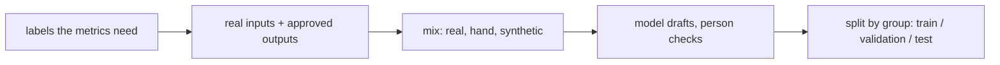

<!-- GENERATED by scripts/generate_skill_pages.py. Do not edit by hand. -->

# gold-set

Plan the reference set an agent's metrics run on: the example schema, where real inputs come from, which approved outputs already exist, the mix of real, hand-written and model-made examples, who drafts and who checks labels, and a train / validation / test split grouped to prevent leakage. Read-only. Link 4 of the SIA audit chain; reads the metric-signature envelope. Use before any optimizer run, or when an eval set was written in an afternoon and never split.

---

**License:** MIT | **Security:** CLEAN


## Install

```bash
brunnr install gold-set
```


---

## Security Scan

!!! success "CLEAN — 0 findings"
    This skill passed all 7+1 threat class checks with no findings.


---

## File Info

| Property | Value |
|----------|-------|
| **Path** | `skills/gold-set/SKILL.md` |
| **Size** | 6.2 KB |
| **SHA-256** | `0ef02c310fd0035b20a41407dd84455f4725bd5d591ab0012a678dd9951a5572` |
| **README** | `skills/gold-set/README.md` |

---

## Skill Prompt

### Gold Set

A metric needs examples with known answers. This skill plans that set: what one example looks
like, where real ones come from, who labels them, and how they're split so the score on the test
set means something.

#### Rules

- **Read-only.** Don't edit files, run the agent, or make model or API calls.
- **Evidence or "unknown".** Every claim cites `path:line` or a quote from the operator.
- **Real inputs first.** Hand-written and model-made examples fill gaps; they don't replace real
  usage.
- **Split before scoring.** The split is fixed before anyone looks at a score, and the test set is
  scored once, at the end.
- **Never invent an upstream verdict.** If a field you read is missing, ask for it or reconstruct
  it and list it under `out.reconstructed`.

#### Step 0: Deployment type

| type | real inputs | approved outputs (drafts vs. finals) |
|---|---|---|
| `coding-harness` | PRs, issues, session transcripts | merged diffs, resolved review comments |
| `gateway-agent` | channel messages | the user's corrections, the version the user kept |
| `framework-app` | requests in traces (LangSmith, Langfuse, OTel) | outcomes in the app: final queue, resolved ticket |
| `prompt-program` | existing devset / trainset files | labels in those files |
| `hosted-nocode` | conversation exports | the version a person sent after editing |

#### Step 1: Read what the metrics need

From the `metric-signature` envelope read `metrics[].outputField` and `metrics[].labelsNeeded`.
Each label needed becomes a label column in the example schema.

#### Step 2: Find real inputs and existing approved outputs

Search the places in the Step 0 table. Look for pairs of draft and approved version: a draft
someone edited before sending, and a reviewer's change, are labels the team already made. Count
what exists per source.

#### Step 3: Choose sources

For each source: `kind` (`real`, `hand`, `synthetic`), where it lives, and a target count. Use
`hand` for edge cases real usage hasn't produced yet, and `synthetic` only with a person checking
every item.

#### Step 4: Plan labeling

A model may draft labels. A person checks every label that goes into validation or test. Write a
one-page labeling guide: each label's definition, two examples, and how to resolve a tie. A label
with no written definition is a gap.

#### Step 5: Split and size

- Split into train / validation / test, plus dev if the team iterates on prompts by hand.
- **Group by source** (the same customer, conversation, PR or template) so near-duplicates stay on
  one side. Name the `groupBy` key.
- **Size in the tens to hundreds.** As a starting point, about 30 to 300 examples each for
  training and validation, with most of them in validation. Count groups, not items: thirty items
  from five sources are five groups.
- List leakage checks: no group on both sides, no demo drawn from validation or test, no example
  text in the prompt.

#### Output

```markdown
### Gold Set: <agent name>

**One example:** inputs <…> → labels <…>

| Source | Kind | Where | Exists now | Target |
|---|---|---|---|---|

**Labeling:** drafter <…>, checker <…>, guide <where it will live>
**Split:** train / validation / test (dev?), grouped by <key>
**Leakage checks:** <list>
```

Then the envelope as the last fenced block, then the footer line. The envelope must parse as
YAML: put double quotes around every free-text value (names, `title`, `why`, `do`, each
`evidence` item, claims), because a `: ` or a leading quote inside an unquoted value breaks the
parse. Every key keeps its colon, as in the template (`effort: S`, `impact: medium`); write `medium`,
not `med`.

```yaml
sia:
  skill: gold-set
  version: 1
  agent: { name: "<name>", summary: "<one line>" }
  deploymentType: <type>
  in_ref: metric-signature#v1     # or "none"
  out:
    exampleSchema: { inputs: [invoice_text], labels: [approved_vendor_id] }
    sources:
      - { kind: real, location: "AP system export", targetCount: 160 }
    labelingPlan: { drafter: "model", checker: "AP lead", guide: "docs/labels.md (to write)" }
    split: { train: 30, validation: 100, test: 30, groupBy: vendor }
    leakageChecks: ["no vendor on both sides of a split", "demos drawn from train only"]
  recommendations:
    - id: gs-1
      effort: M
      impact: high
      title: "<imperative, one line>"
      why: "<one line tied to evidence>"
      do: "<a step an agent or engineer can do without rereading the report>"
      evidence: ["<path:line>"]   # or "unknown (ask: <question>)"
      next_skill: eval-power
      links: []
```

> Series and help: peleke.me · LinkedIn

**Recommendations:** at most seven, each with evidence or `unknown (ask: …)`. No pitching.
- Order by what each item unblocks: item 1 is the one the others depend on.
- Size each item (S, M, L) for everything its `do` includes, prerequisites too.
- Each `do` stands alone: no "see above", one named choice rather than an either/or.
- A claim resting on one incident is a hypothesis; say "one case" and what would confirm it. A
  claim that something is absent (no reader, never measured) names where you searched.

#### Gotchas

- An eval set written by one person in one sitting is one source. It counts as one group.
- Scoring on the set the optimizer chose demos from doesn't measure held-out performance.
- Model-made examples tend to be easier than real ones. Report their share.
- "Approved" outputs that nobody reviewed are drafts. Check who signed off.

#### Examples

- Invoice extractor whose AP system keeps the approved vendor per invoice → real source, labels
  already exist (the approved vendor), group by vendor, draft-by-model unnecessary.
- Ax extractor with 25 hand-written examples and no test set → add real documents, split by source
  before the next optimizer run, keep the 25 as one group.

---

## README

### gold-set

**Your metric needs answers to check against. Plan them before you score anything.**

Part of the SIA (self-improving agent) audit chain: [learning-check](https://github.com/Peleke/brunnr/blob/main/skills/learning-check) → [signal-card](https://github.com/Peleke/brunnr/blob/main/skills/signal-card) → [metric-signature](https://github.com/Peleke/brunnr/blob/main/skills/metric-signature) → [field-table](https://github.com/Peleke/brunnr/blob/main/skills/field-table) → **gold-set** → [eval-power](https://github.com/Peleke/brunnr/blob/main/skills/eval-power)

#### 1. Quickstart

```bash
brunnr install gold-set
```

Then ask your agent: *"Plan a gold set for this agent's metrics."* The skill is read-only: it cites a file and line for every finding and makes no model or API calls of its own.

#### 2. Concept

A gold set is the reference input/output pairs a metric runs on, split so the final score means something. This skill plans it: what one example looks like, where real inputs come from, which approved outputs already exist (drafts people edited before sending are labels you already have), who drafts and who checks labels, and a train / validation / test split grouped so near-duplicates don't leak across it.



#### 3. Method

Real usage comes first because hand-written and model-made examples tend to be easier than the real thing. Splits are grouped by source because near-duplicates on both sides inflate the score. Size sits in the tens to hundreds: enough to tell candidates apart, small enough to label by hand.

Sources:

- Smorodinsky & Kennedy, *Building LLM Applications with DSPy* (Manning), ch. 4 §4.1.2–4.1.3: train / validation / test splits, cross-validation, and "about 30 to 300 examples for each of training and validation, with the bulk of these reserved for validation" (read 2026-11-18)
- [Ax: Optimization](https://axllm.dev/typescript/concepts/optimization/): "Normalize scores to `0..1` when possible" and "Use distinct validation examples when selecting a best candidate" (read 2026-11-18)

#### 4. Rubric

| Criterion | Pass condition | Evidence required |
|---|---|---|
| Real inputs | examples drawn from real usage, with counts per source | the source location |
| Labels defined | every scored field has a label with a written definition | the labeling guide |
| Split before scoring | the split is fixed before any score is looked at | the split plan |
| Grouping | a `groupBy` key keeps near-duplicates on one side | the key and why |
| Size | in the tens-to-hundreds band, counted in groups | the target counts |
| Test once | the test set is scored once, at the end | the plan |

#### 5. Inputs and outputs

**Reads:** `deploymentType`, `metrics[].labelsNeeded`, `metrics[].outputField` from `metric-signature`. If no upstream envelope is in context, the skill asks for those fields or reconstructs them from the code and marks them `reconstructed`. It never invents an upstream verdict.

**Writes:** a report a person can read, ending in one `sia:` YAML envelope with `out`: `exampleSchema`, `sources`, `labelingPlan`, `split`, `leakageChecks`. The next skill reads it. The full convention is in [`_sia-chain.md`](https://github.com/Peleke/brunnr/blob/main/skills/_sia-chain.md).

Every run first places the agent in one deployment type, which tells the skill where to look for evidence:

| `deploymentType` | examples |
|---|---|
| `coding-harness` | Claude Code, Codex, Cursor |
| `gateway-agent` | OpenClaw |
| `framework-app` | LangGraph, CrewAI, OpenAI / Claude Agent SDK, Mastra, Google ADK |
| `prompt-program` | DSPy, Ax |
| `hosted-nocode` | custom GPTs, n8n, Copilot Studio |

#### 6. Recommendations

Each report ends with at most seven recommendations, ordered by leverage. Each has `id` (`gs-1`, …), `title`, `why`, `do`, `effort` (S / M / L), `impact` (high / medium / low), `evidence` (paths with line numbers, or `unknown (ask: …)`), `next_skill` and `links`. `do` is written so an agent or an engineer can act on it without rereading the report.

File them as GitHub issues (needs `yq` and `gh`; save the envelope as `report.yaml`):

```bash
yq -o=json '.sia.recommendations[]' report.yaml | jq -c '.' | while read -r r; do gh issue create --title "$(jq -r .title <<<"$r")" --body "$(jq -r '"Why: \(.why)\n\nDo: \(.do)\n\nEffort: \(.effort) · Impact: \(.impact)\nEvidence: \(.evidence|if type=="array" then join(", ") else . end)\nNext: \(.next_skill)"' <<<"$r")"; done
```

#### 7. Run it anywhere

The skill is a plain [Agent Skills](https://agentskills.io/specification) folder: one `SKILL.md` with `name`, `description` and `license`, nothing tool-specific.

| Tool | Where the folder goes |
|---|---|
| brunnr | `brunnr install gold-set` (into `skills/gold-set/`), or `brunnr install gold-set --target <dir>` |
| Claude Code | `.claude/skills/gold-set/` in a project, or `~/.claude/skills/gold-set/` for all projects ([docs](https://code.claude.com/docs/en/skills), read 2026-11-18) |
| Codex | `.agents/skills/gold-set/` in a repo, or `$HOME/.agents/skills/gold-set/` ([docs](https://developers.openai.com/codex/skills), read 2026-11-18) |
| Other tools that read Agent Skills | not verified here; check your tool's docs for its skills directory |

**No skills support?** Paste this as your first message, then describe or attach the agent:

```text
Follow the instructions below exactly. Audit the agent I describe next. Read-only: don't run it.
End with the YAML envelope the instructions specify.

<paste the contents of skills/gold-set/SKILL.md here>
```

#### 8. Next

Next link: [`eval-power`](https://github.com/Peleke/brunnr/blob/main/skills/eval-power): check whether this eval can detect the change you care about.

Series: B0 · Gold sets (forthcoming). The chain's conventions: [`_sia-chain.md`](https://github.com/Peleke/brunnr/blob/main/skills/_sia-chain.md).

Series and help: [peleke.me](https://peleke.me) · LinkedIn

---

*Drafted with AI assistance, edited by me.*
