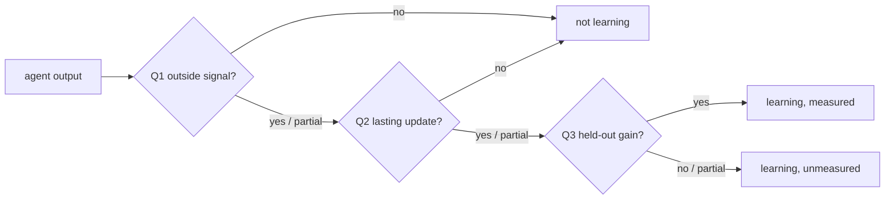

<!-- GENERATED by scripts/generate_skill_pages.py. Do not edit by hand. -->

# learning-check

Audit an agent (a repo, a service, or a written description) for the three properties of learning: a feedback signal from outside the model, a lasting update, and measurable improvement on held-out examples. Answers per loop, gives each loop an outcome (no loop found, not learning, learning unmeasured, learning measured), and names the first thing to fix. Read-only. Link 1 of the SIA audit chain. Use when asking "does my agent actually learn?", before adding a memory feature, or before reaching for an optimizer.

---

**License:** MIT | **Security:** CLEAN


## Install

```bash
brunnr install learning-check
```


---

## Security Scan

!!! success "CLEAN — 0 findings"
    This skill passed all 7+1 threat class checks with no findings.


---

## File Info

| Property | Value |
|----------|-------|
| **Path** | `skills/learning-check/SKILL.md` |
| **Size** | 7.0 KB |
| **SHA-256** | `ce8f39b1c262c5187882e14e6041baaa57c63f03c9fb18d5ceb345043d1159fb` |
| **README** | `skills/learning-check/README.md` |

---

## Skill Prompt

### Learning Check

Answer three questions about each loop an agent has, with evidence for each answer. Memory
features (the model writes notes and reads them back) usually fail at least one: nothing records
how much a note changed, so a note confirmed a hundred times counts the same as one invented once.

#### Rules

- **Read-only.** Do not edit files, run the agent, or make model or API calls.
- **Evidence or "no".** Every "yes" or "partial" cites a file path (with line numbers) or a
  quoted sentence from the operator's description. No evidence means the answer is "no"; say
  where you looked.
- **The model grading itself is not a signal.** A second call to the same model counts as the
  model reviewing itself.
- **A person carrying the signal or applying the change makes the answer "partial"**, not yes.

#### Step 0: Job and deployment type

Write the agent's job in one sentence. Then place it in one deployment type; the type tells you
where to look.

| type | prompts / instructions | signals / feedback | traces / data |
|---|---|---|---|
| `coding-harness` (Claude Code, Codex, Cursor) | CLAUDE.md / AGENTS.md, skills, rules | PR review outcomes, reverted diffs, hooks | session transcripts |
| `gateway-agent` (OpenClaw) | workspace skills, memory files | user corrections in channel | channel logs |
| `framework-app` (LangGraph, CrewAI, agent SDKs) | prompts in code | thumbs, escalations, task outcomes | LangSmith / Langfuse / OTel traces |
| `prompt-program` (DSPy, Ax) | signatures | existing metrics | eval sets, optimizer logs |
| `hosted-nocode` (custom GPTs, n8n, Copilot Studio) | instructions in the UI | ratings, edits | conversation exports |

#### Step 1: Find the loops

A **loop** is one signal source feeding one artifact that changes (user corrections → a memory
file; labeled examples → a demo set). Answer the three questions once per loop. Things that only
steer the next step inside one run (a tool loop, a retry, a self-check) get a one-line note, not a
loop. If nothing feeds any artifact, the outcome is **no loop found**: describe the loop you'd
want, mark it "proposed", and answer no to all three.

#### Step 2: The three questions, per loop

| | yes | partial | no |
|---|---|---|---|
| **Q1** When it gets something wrong, what tells it? | A signal the model can't produce by reviewing itself (a test, CI, a tool's exit code, a user, a label, a human click) reaches the agent without anyone carrying it, and says whether the output was right | Such a signal exists but a person has to carry it to the agent; or the only judge is a separate LLM not checked against people | Only the model reviewing itself, or nothing |
| **Q2** When that happens, what changes, and how much? | A change survives across runs, is applied without a person, and is recorded in a unit you can diff | A change persists but its size isn't recorded; or it's computed once and never saved; or a person applies it | Nothing outlasts one run |
| **Q3** Is it measurably better over time? | A score on held-out examples, compared with a baseline, recorded more than once | A held-out set or a baseline exists, but they aren't run together | No held-out number |

#### Step 3: Outcome per loop

- **not learning:** Q1 is no, or Q2 is no, or a person both carries the signal and applies the
  change and Q3 is no. That's the person learning, not the agent.
- **learning, unmeasured:** Q1 and Q2 are yes or partial; Q3 is no or partial.
- **learning, measured:** Q1 and Q2 are yes or partial; Q3 is yes.
- Add **(partial loop)** to a learning outcome when Q1 or Q2 is partial.

**Headline:** the best loop's outcome, naming the loop.

#### Output

```markdown
### Learning Check: <agent name>

**Job:** <one sentence> · **Type:** <deploymentType>

#### Loop: <name>

| # | Question | Verdict | Evidence |
|---|---|---|---|
| 1 | What tells it it was wrong? | yes / partial / no | path:line or quote |
| 2 | What changes when it's wrong? | yes / partial / no | path:line or quote |
| 3 | Is it measurably better over time? | yes / partial / no | path:line or quote |

**Outcome:** <outcome for this loop>

**Headline:** <best loop's outcome (loop name); other loops: …>

**Memory vs learning:** <one sentence: does any "memory" feature here record how much it changed?>

**First fix:** <start at the first question that isn't "yes" in the best loop; one concrete step>
```

Then the envelope as the last fenced block, then the footer line. `verdicts` are the headline
loop's answers; `loops` lists every loop.

```yaml
sia:
  skill: learning-check
  version: 1
  agent: { name: "<name>", summary: "<one line>" }
  deploymentType: <type>
  in_ref: none
  out:
    verdicts: { signal: partial, update: partial, convergence: "no" }
    loops:
      - { name: "<loop>", signal: partial, update: partial, convergence: "no", outcome: "not learning", evidence: ["<path:line>"] }
    outcome: "not learning"       # headline: no loop found | not learning | learning, unmeasured | learning, measured, plus " (partial loop)"
    firstFix: "<one concrete step>"
  recommendations:
    - id: lc-1
      title: <imperative, one line>
      why: <one line tied to evidence>
      do: <a step an agent or engineer can do without rereading the report>
      effort: S                   # S | M | L
      impact: high                # high | medium | low
      evidence: ["<path:line>"]   # or "unknown (ask: <question>)"
      next_skill: signal-card
      links: []
```

> Series and help: peleke.me · LinkedIn

**Recommendations:** at most seven, ordered by leverage, each with evidence or
`unknown (ask: …)`. No pitching. Quote `"no"` in YAML so it stays a string.

#### Gotchas

- An eval that exists but never runs is "partial" on Q3, not "yes".
- Logging every output is not a signal unless something marks outputs right or wrong.
- Don't count the optimizer's training score as convergence; only held-out scores count.
- A person editing the prompt after noticing failures, with no eval, is "not learning": the person
  carries the signal and applies the change.

#### Examples

- "Run a learning check on this repo" → locate the agent in code, find its loops, fill one table
  per loop from the files.
- "My assistant appends a line to its memory file when I correct it in chat. Does it learn?" →
  Q1 yes (corrections reach it), Q2 partial (the file persists; nothing records how much changed),
  Q3 no. Outcome: learning, unmeasured (partial loop). First fix: record per correction which
  memory line it added, and count repeat corrections.

---

## README

### learning-check

**Does your agent learn, or do you? Three questions, answered with evidence.**

Part of the SIA (self-improving agent) audit chain: **learning-check** → [signal-card](https://github.com/Peleke/brunnr/blob/main/skills/signal-card) → [metric-signature](https://github.com/Peleke/brunnr/blob/main/skills/metric-signature) → [field-table](https://github.com/Peleke/brunnr/blob/main/skills/field-table) → [gold-set](https://github.com/Peleke/brunnr/blob/main/skills/gold-set) → [eval-power](https://github.com/Peleke/brunnr/blob/main/skills/eval-power)

#### 1. Quickstart

```bash
brunnr install learning-check
```

Then ask your agent: *"Run a learning check on this repo."* The skill is read-only: it cites a file and line for every finding and makes no model or API calls of its own.

#### 2. Concept

Take one agent you run and answer three questions about each of its loops:

1. **When it gets something wrong, what tells it?** Something outside the model: a test, a review, a user.
2. **When that happens, what changes, and by how much?**
3. **Is it measurably better over time,** on examples it didn't train on?

If the answer to the first two is "I fix the prompt", the learning is happening in you, not in the agent. Most "learning" features are memory: the model writes notes and reads them back, and nothing records how much any note changed.



#### 3. Method

Each question removes one way an agent can look like it learns without learning: a signal the model makes up about itself (Q1), a change nobody can measure or that a person applies by hand (Q2), and a score on the same examples the change was tuned on (Q3). The outcome rule is a pure function; `brunnr.sia_chain.learning_outcome` implements it and a test checks all 54 combinations.

Sources:

- [Learning Is Not Memory](https://peleke.me/writing/learning-is-not-memory) (2026-03-09): the longer argument for the three questions
- Smorodinsky & Kennedy, *Building LLM Applications with DSPy* (Manning), ch. 4 §4.2.4: one metric for tuning, several for the final evaluation, and Goodhart's law (read 2026-11-18)
- [Ax: Optimization](https://axllm.dev/typescript/concepts/optimization/): "Normalize scores to `0..1` when possible" and "Use distinct validation examples when selecting a best candidate" (read 2026-11-18)

#### 4. Rubric

| Criterion | Pass condition | Evidence required |
|---|---|---|
| Q1 outside signal | a signal the model can't make by reviewing itself reaches the agent without a person carrying it | path:line of where the outcome is recorded, or the operator's quote |
| Q2 lasting update | a change survives across runs, applied without a person, recorded in a unit you can diff | path:line of the code that applies it |
| Q3 measured gain | a held-out score compared with a baseline, recorded more than once | dated result files or CI output |
| Outcome | follows the rule from Q1–Q3 and whether one person carries and applies | the three verdicts |

#### 5. Inputs and outputs

**Reads:** nothing (first link). Point it at a repo, a service, or a written description.. If no upstream envelope is in context, the skill asks for those fields or reconstructs them from the code and marks them `reconstructed`. It never invents an upstream verdict.

**Writes:** a report a person can read, ending in one `sia:` YAML envelope with `out`: `verdicts` (the headline loop's Q1–Q3), `loops`, `outcome`, `firstFix`. The next skill reads it. The full convention is in [`_sia-chain.md`](https://github.com/Peleke/brunnr/blob/main/skills/_sia-chain.md).

Every run first places the agent in one deployment type, which tells the skill where to look for evidence:

| `deploymentType` | examples |
|---|---|
| `coding-harness` | Claude Code, Codex, Cursor |
| `gateway-agent` | OpenClaw |
| `framework-app` | LangGraph, CrewAI, OpenAI / Claude Agent SDK, Mastra, Google ADK |
| `prompt-program` | DSPy, Ax |
| `hosted-nocode` | custom GPTs, n8n, Copilot Studio |

#### 6. Recommendations

Each report ends with at most seven recommendations, ordered by leverage. Each has `id` (`lc-1`, …), `title`, `why`, `do`, `effort` (S / M / L), `impact` (high / medium / low), `evidence` (paths with line numbers, or `unknown (ask: …)`), `next_skill` and `links`. `do` is written so an agent or an engineer can act on it without rereading the report.

File them as GitHub issues (needs `yq` and `gh`; save the envelope as `report.yaml`):

```bash
yq -o=json '.sia.recommendations[]' report.yaml | jq -c '.' | while read -r r; do gh issue create --title "$(jq -r .title <<<"$r")" --body "$(jq -r '"Why: \(.why)\n\nDo: \(.do)\n\nEffort: \(.effort) · Impact: \(.impact)\nEvidence: \(.evidence|join(", "))\nNext: \(.next_skill)"' <<<"$r")"; done
```

#### 7. Run it anywhere

The skill is a plain [Agent Skills](https://agentskills.io/specification) folder: one `SKILL.md` with `name`, `description` and `license`, nothing tool-specific.

| Tool | Where the folder goes |
|---|---|
| brunnr | `brunnr install learning-check` (into `skills/learning-check/`), or `brunnr install learning-check --target <dir>` |
| Claude Code | `.claude/skills/learning-check/` in a project, or `~/.claude/skills/learning-check/` for all projects ([docs](https://code.claude.com/docs/en/skills), read 2026-11-18) |
| Codex | `.agents/skills/learning-check/` in a repo, or `$HOME/.agents/skills/learning-check/` ([docs](https://developers.openai.com/codex/skills), read 2026-11-18) |
| Other tools that read Agent Skills | not verified here; check your tool's docs for its skills directory |

**No skills support?** Paste this as your first message, then describe or attach the agent:

```text
Follow the instructions below exactly. Audit the agent I describe next. Read-only: don't run it.
End with the YAML envelope the instructions specify.

<paste the contents of skills/learning-check/SKILL.md here>
```

#### 8. Next

Next link: [`signal-card`](https://github.com/Peleke/brunnr/blob/main/skills/signal-card): name the signal your agent should learn from.

Series: 01 · Does your agent learn?. The chain's conventions: [`_sia-chain.md`](https://github.com/Peleke/brunnr/blob/main/skills/_sia-chain.md).

Series and help: [peleke.me](https://peleke.me) · LinkedIn

---

*Drafted with AI assistance, edited by me.*
