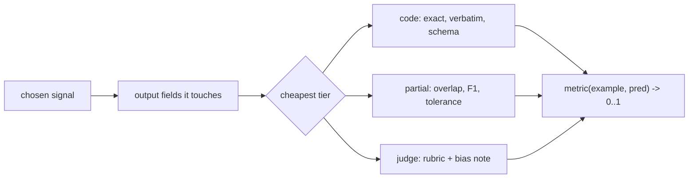

<!-- GENERATED by scripts/generate_skill_pages.py. Do not edit by hand. -->

# metric-signature

Turn an agent's chosen learning signal into metric functions: the cheapest check that can tell a good output from a bad one, written as a DSPy-style Python signature, an Ax-style TypeScript signature and plain language, normalized to 0..1, with a named do-nothing baseline. Read-only. Link 3 of the SIA audit chain; reads the signal-card envelope. Use after signal-card, before building a gold set, or when an optimizer needs a metric and nobody has written one.

---

**License:** MIT | **Security:** CLEAN


## Install

```bash
brunnr install metric-signature
```


---

## Security Scan

!!! success "CLEAN — 0 findings"
    This skill passed all 7+1 threat class checks with no findings.


---

## File Info

| Property | Value |
|----------|-------|
| **Path** | `skills/metric-signature/SKILL.md` |
| **Size** | 7.1 KB |
| **SHA-256** | `c28f1554c56aa7dcf630f6695f3d75294eebc724f3bbe2519a55e838f703c263` |
| **README** | `skills/metric-signature/README.md` |

---

## Skill Prompt

### Metric Signature

An optimizer only climbs what the metric measures. This skill writes the metric down before
anyone builds a dataset or runs a search: which output fields it scores, how cheaply, on what
scale, and what "doing nothing" scores.

#### Rules

- **Read-only.** Don't edit files, run the agent, or make model or API calls.
- **Evidence or "unknown".** Every claim cites `path:line` or a quote from the operator.
- **Cheapest adequate tier.** Use code before partial credit, and partial credit before a judge.
  Use an LLM judge only when nothing cheaper can tell good from bad, and say why.
- **Scores run from 0 to 1.** Higher is better.
- **Never invent an upstream verdict.** If a field you read is missing, ask for it or reconstruct
  it from the code and list it under `out.reconstructed`.

#### Step 0: Deployment type

Place the agent in one type; it tells you where outputs and labels live.

| type | outputs are defined in | labels / outcomes live in |
|---|---|---|
| `coding-harness` | skill files, CLAUDE.md / AGENTS.md | PR review outcomes, reverted diffs |
| `gateway-agent` | workspace skills | corrections in the channel |
| `framework-app` | structured-output schemas in code | thumbs, escalations, task outcomes, traces |
| `prompt-program` | DSPy / Ax signatures | eval sets, existing metric functions |
| `hosted-nocode` | instructions in the UI | ratings, edits, conversation exports |

#### Step 1: Read the signal

From the `signal-card` envelope read `chosenSignal` and `slots.artifact`. Without an envelope, ask
for the one line "My agent gets better when ___ goes up", or reconstruct it from the code.

#### Step 2: List the output fields the signal touches

Name each output field (with `path:line` where it is defined) whose value changes the signal. A
field the signal doesn't touch goes in `fieldsUnscored`, with no metric.

#### Step 3: Pick a tier per field

| tier | use when | examples |
|---|---|---|
| `code` | the right answer can be checked exactly | exact match, verbatim span, schema valid, label equality |
| `partial` | closeness matters more than exactness | token overlap, set F1, numeric tolerance |
| `judge` | only a reader can tell | an LLM grades against a written rubric |

For every `judge` metric, write the rubric (criteria and pass conditions) and one line on judge
bias: position, length, and self-preference when the judge shares a model with the agent.

#### Step 4: Write the signature three ways

- **Python (DSPy shape):** `def metric(example, pred, trace=None) -> float`. DSPy accepts a
  float, int or bool; return a float in 0..1.
- **TypeScript (Ax shape):** `({ prediction, example }) => number`, normalized to 0..1.
- **Plain language:** one sentence a reviewer can check by hand.

For GEPA, say whether the metric can also return feedback text
(`dspy.Prediction(score=..., feedback=...)`). Code-tier metrics usually can: say which check failed.

#### Step 5: Baseline and labels

- **Baseline:** what a do-nothing version scores (always the majority label, an empty answer, or the
  current prompt unchanged). Without a baseline, no gain can be claimed.
- **Labels needed:** for each metric, the reference values it compares against (`labelsNeeded`).
  `gold-set` plans how to collect them.

#### Output

```markdown
### Metric Signature: <agent name>

**Signal:** <chosenSignal, and where it came from>

| Metric | Output field | Tier | Labels needed | Feedback text |
|---|---|---|---|---|

<for each metric: the Python, TypeScript and plain-language signatures>

**Baseline:** <do-nothing version and its expected score, or "unknown (ask: …)">
**Unscored fields:** <fields the signal doesn't touch>
```

Then the envelope as the last fenced block, then the footer line. The envelope must parse as
YAML: put double quotes around every free-text value (names, `title`, `why`, `do`, each
`evidence` item, claims), because a `: ` or a leading quote inside an unquoted value breaks the
parse. Write `effort` as `S`, `M` or `L` and `impact` as `high`, `medium` or `low`, in full.

```yaml
sia:
  skill: metric-signature
  version: 1
  agent: { name: "<name>", summary: "<one line>" }
  deploymentType: <type>
  in_ref: signal-card#v1          # or "none"
  out:
    metrics:
      - name: vendor_exact
        outputField: vendor_id
        tier: code                # code | partial | judge
        range: "0..1"
        feedbackText: true
        labelsNeeded: [approved_vendor_id]
        signature:
          python: "def metric(example, pred, trace=None) -> float: return float(pred.vendor_id == example.approved_vendor_id)"
          typescript: "({ prediction, example }) => (prediction.vendor_id === example.approved_vendor_id ? 1 : 0)"
          plain: "1 when the extracted vendor equals the vendor the AP clerk approved, else 0"
    baseline: "always the most frequent vendor"
    fieldsUnscored: [notes, currency]
  recommendations:
    - id: ms-1
      title: "<imperative, one line>"
      why: "<one line tied to evidence>"
      do: "<a step an agent or engineer can do without rereading the report>"
      effort: S                   # S | M | L
      impact: high                # high | medium | low
      evidence: ["<path:line>"]   # or "unknown (ask: <question>)"
      next_skill: gold-set
      links: []
```

> Series and help: peleke.me · LinkedIn

**Recommendations:** at most seven, each with evidence or `unknown (ask: …)`. No pitching.
- Order by what each item unblocks: item 1 is the one the others depend on.
- Size `effort` for everything the `do` includes, prerequisites too.
- Each `do` stands alone: no "see above", one named choice rather than an either/or.
- A claim resting on one incident is a hypothesis; say "one case" and what would confirm it. A
  claim that something is absent (no reader, never measured) names where you searched.

#### Gotchas

- A metric on a field nothing reads optimizes nothing. Check `fieldsUnscored` against the consumers.
- Exact match on free text almost always reads as 0. Use partial credit or a verbatim span instead.
- A judge that shares a model with the agent tends to prefer its own outputs. Name that bias.
- A boolean metric is fine for DSPy demo bootstrapping, but averaging over examples needs floats.

#### Examples

- Invoice extractor with a `vendor_id` field and the clerk's approved value → one `code` metric
  (vendor exact match), labels = approved vendor, baseline = most frequent vendor; every other
  output field the signal doesn't touch goes in `fieldsUnscored`.
- Meeting-summary bot whose users edit the summary before posting → a `partial` metric (token
  overlap of the draft with the posted version); "summary was useful" ratings noted as a slower
  signal, not the metric.

---

## README

### metric-signature

**A signal becomes a metric once you write it as a function.**

Part of the SIA (self-improving agent) audit chain: [learning-check](https://github.com/Peleke/brunnr/blob/main/skills/learning-check) → [signal-card](https://github.com/Peleke/brunnr/blob/main/skills/signal-card) → **metric-signature** → [field-table](https://github.com/Peleke/brunnr/blob/main/skills/field-table) → [gold-set](https://github.com/Peleke/brunnr/blob/main/skills/gold-set) → [eval-power](https://github.com/Peleke/brunnr/blob/main/skills/eval-power)

#### 1. Quickstart

```bash
brunnr install metric-signature
```

Then ask your agent: *"Write the metric signature for this agent's signal."* The skill is read-only: it cites a file and line for every finding and makes no model or API calls of its own.

#### 2. Concept

An optimizer climbs whatever the metric measures, so the metric holds the signal. "My agent gets better when ___ goes up" becomes `metric(example, prediction) -> float`.

This skill picks the cheapest check that can tell a good output from a bad one (exact match before partial credit, and partial credit before an LLM judge), writes it as a Python and a TypeScript signature plus one plain sentence, normalizes it to 0..1, and names what a do-nothing version scores. Without that baseline, no gain can be claimed.



#### 3. Method

Cheaper tiers come first because they're deterministic and free to run thousands of times; a judge adds cost, variance and its own biases. Scores are normalized to 0..1 so metrics can be compared and combined. The signature follows the shapes the two main prompt-optimization libraries accept, so it drops into either.

Sources:

- [DSPy: Metrics](https://dspy.ai/learn/evaluation/metrics/): a metric takes `example` and `pred` and returns a `float`, `int` or `bool`; the optional `trace` argument switches it to bootstrapping mode (read 2026-11-18)
- [DSPy: GEPA overview](https://dspy.ai/api/optimizers/GEPA/overview/): a GEPA metric returns a float or `dspy.Prediction(score=..., feedback=...)`; the feedback text is what GEPA reflects on (`GEPAFeedbackMetric` in `dspy/teleprompt/gepa/gepa.py` returns `Union[float, ScoreWithFeedback]`) (read 2026-11-18)
- [Ax: Optimization](https://axllm.dev/typescript/concepts/optimization/): "Normalize scores to `0..1` when possible" and "Use distinct validation examples when selecting a best candidate" (read 2026-11-18)
- [Ax source, `AxMetricFn`](https://github.com/ax-llm/ax/blob/main/src/ax/dsp/common_types.ts): `({ prediction, example }) => number` (read 2026-11-18)

#### 4. Rubric

| Criterion | Pass condition | Evidence required |
|---|---|---|
| Maps to the signal | every metric scores a field the chosen signal touches | the signal-card envelope, or the operator's quote |
| Cheapest tier | code before partial before judge, with the reason for any judge | the field's definition, path:line |
| Range | 0..1, higher is better | the signature |
| Labels | the reference values each metric needs are named | where they would come from |
| Baseline | a do-nothing version and its expected score | the majority label or current output |
| Judge rubric | judge-tier metrics have a written rubric and a bias note | the rubric text |

#### 5. Inputs and outputs

**Reads:** `deploymentType`, `chosenSignal`, `slots.artifact` from `signal-card`. If no upstream envelope is in context, the skill asks for those fields or reconstructs them from the code and marks them `reconstructed`. It never invents an upstream verdict.

**Writes:** a report a person can read, ending in one `sia:` YAML envelope with `out`: `metrics` (each with `outputField`, `tier`, `range`, `feedbackText`, `labelsNeeded`, `signature`), `baseline`, `fieldsUnscored`. The next skill reads it. The full convention is in [`_sia-chain.md`](https://github.com/Peleke/brunnr/blob/main/skills/_sia-chain.md).

Every run first places the agent in one deployment type, which tells the skill where to look for evidence:

| `deploymentType` | examples |
|---|---|
| `coding-harness` | Claude Code, Codex, Cursor |
| `gateway-agent` | OpenClaw |
| `framework-app` | LangGraph, CrewAI, OpenAI / Claude Agent SDK, Mastra, Google ADK |
| `prompt-program` | DSPy, Ax |
| `hosted-nocode` | custom GPTs, n8n, Copilot Studio |

#### 6. Recommendations

Each report ends with at most seven recommendations, ordered by leverage. Each has `id` (`ms-1`, …), `title`, `why`, `do`, `effort` (S / M / L), `impact` (high / medium / low), `evidence` (paths with line numbers, or `unknown (ask: …)`), `next_skill` and `links`. `do` is written so an agent or an engineer can act on it without rereading the report.

File them as GitHub issues (needs `yq` and `gh`; save the envelope as `report.yaml`):

```bash
yq -o=json '.sia.recommendations[]' report.yaml | jq -c '.' | while read -r r; do gh issue create --title "$(jq -r .title <<<"$r")" --body "$(jq -r '"Why: \(.why)\n\nDo: \(.do)\n\nEffort: \(.effort) · Impact: \(.impact)\nEvidence: \(.evidence|if type=="array" then join(", ") else . end)\nNext: \(.next_skill)"' <<<"$r")"; done
```

#### 7. Run it anywhere

The skill is a plain [Agent Skills](https://agentskills.io/specification) folder: one `SKILL.md` with `name`, `description` and `license`, nothing tool-specific.

| Tool | Where the folder goes |
|---|---|
| brunnr | `brunnr install metric-signature` (into `skills/metric-signature/`), or `brunnr install metric-signature --target <dir>` |
| Claude Code | `.claude/skills/metric-signature/` in a project, or `~/.claude/skills/metric-signature/` for all projects ([docs](https://code.claude.com/docs/en/skills), read 2026-11-18) |
| Codex | `.agents/skills/metric-signature/` in a repo, or `$HOME/.agents/skills/metric-signature/` ([docs](https://developers.openai.com/codex/skills), read 2026-11-18) |
| Other tools that read Agent Skills | not verified here; check your tool's docs for its skills directory |

**No skills support?** Paste this as your first message, then describe or attach the agent:

```text
Follow the instructions below exactly. Audit the agent I describe next. Read-only: don't run it.
End with the YAML envelope the instructions specify.

<paste the contents of skills/metric-signature/SKILL.md here>
```

#### 8. Next

Next link: [`gold-set`](https://github.com/Peleke/brunnr/blob/main/skills/gold-set): plan the reference set the metric runs on (or `field-table` first, to audit every output field).

Series: 03 · The shape of an eval. The chain's conventions: [`_sia-chain.md`](https://github.com/Peleke/brunnr/blob/main/skills/_sia-chain.md).

Series and help: [peleke.me](https://peleke.me) · LinkedIn

---

*Drafted with AI assistance, edited by me.*
