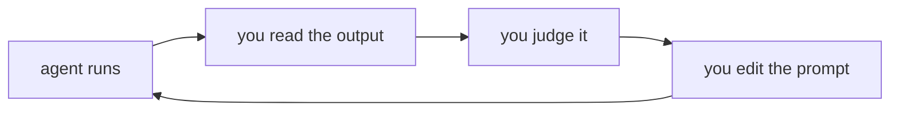
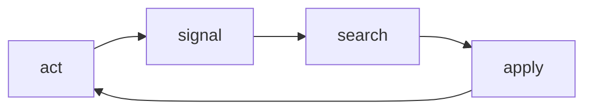

<!-- GENERATED by scripts/generate_skill_pages.py. Do not edit by hand. -->

# signal-card

Name the signal an agent should learn from, in one line ("My agent gets better when ___ goes up"), then lay out the self-improvement loop around it: act, take a signal, search for a better version, apply it. Fills the three choosable slots (signal, search, artifact) with options found in the codebase or the operator's description. Read-only. Use after learning-check, when an agent has no signal, or when "I edit the prompt" is the only improvement path.

---

**License:** MIT | **Security:** CLEAN


## Install

```bash
brunnr install signal-card
```


---

## Security Scan

!!! success "CLEAN — 0 findings"
    This skill passed all 7+1 threat class checks with no findings.


---

## File Info

| Property | Value |
|----------|-------|
| **Path** | `skills/signal-card/SKILL.md` |
| **Size** | 3.5 KB |
| **SHA-256** | `0a56a61b610605cc0300f249b904237876c9ad44e4a8ced6b711e4cc4d1be2b1` |
| **README** | `skills/signal-card/README.md` |

---

## Skill Prompt

### Signal Card

Most agents improve only when a person reads output, judges it, and edits the prompt. That
works until it has to scale, run unattended, or survive an audit. This skill writes down the
signal that would let the agent run that loop itself, and the slots around it.

The loop vocabulary (act → signal → search → apply) follows Micheal Lanham's *Self-Improving
Agents* (Manning).

#### Rules

- **Read-only.** No edits, no agent runs, no model or API calls.
- **The signal comes from outside the model.** A score from a test, a preference between two
  outputs, written feedback from a person, or a confidence value that something external checks.
- **One signal first.** Propose up to three candidates, then recommend one and say why.
- **Cite what exists.** For each slot, prefer options already present in the code (path:line).
  Mark anything new as "to build".

#### Step 1: Current loop

Describe how the agent improves today in four nodes: agent runs → who reads the output → who
judges it → what gets edited. If a person fills the middle two, say "you are the loop".

If a `learning-check` report exists, read it first and reuse its evidence.

#### Step 2: Candidate signals

List up to three candidates. For each: what is measured, where it would come from, how often it
arrives, what it costs, and its type: **score**, **preference**, **feedback**, or **confidence**.

#### Step 3: The one line

Write: **"My agent gets better when ___ goes up."** The blank names one measurable quantity on a
defined set of examples.

#### Step 4: The slots

| Slot | Options | Pick for now |
|---|---|---|
| Signal | score · preference · feedback · confidence | the recommended candidate |
| Search | hill-climbing · an evolutionary optimizer such as GEPA · person reviewing proposals | the cheapest that fits |
| Artifact | prompt / instructions · demos · skill file · memory · code | what the search will change |

#### Output

```markdown
### Signal Card: <agent name>

**Today:** <four-node loop; "you are the loop" if applicable>

**My agent gets better when <quantity> goes up.**

| Candidate | Type | Source | Frequency | Cost |
|---|---|---|---|---|

**Slots:** Signal = … · Search = … · Artifact = …

**Next step:** write the signal as a metric function (`metric(example, prediction) -> float`),
then run `field-table` on every output the metric touches.
```

#### Gotchas

- "User satisfaction" is not a signal until you say how it's recorded per output.
- A signal that arrives once a quarter can't drive search; pair it with a faster proxy and say so.
- If the honest answer is "when I edit the prompt", that is the finding. Don't dress it up.

#### Examples

- Code-review bot: "My agent gets better when the share of its comments that authors resolve
  (not dismiss) goes up." Type: preference. Search: person reviews proposed instruction changes.
  Artifact: instructions.
- Changelog summarizer: "…when the share of summary quotes found verbatim in the source goes up."
  Type: score. Search: bootstrap demos. Artifact: demos.

---

## README

### Signal Card

**Name the signal your agent learns from.**

Write one line:

> My agent gets better when ___ goes up.

If you can't fill in the blank, your agent has no signal. It can't improve on its own, whatever its memory feature is called.

#### You are probably the loop

If the honest answer is "when I notice something wrong and edit the prompt", then you are the improvement loop. You read the output, judge it, decide what to change, and rerun. That works...until it has to scale, run while you sleep, or survive an audit.



#### The loop with the steps named

Micheal Lanham's *Self-Improving Agents* (Manning) describes a self-improving agent as a loop with four steps: act, take a signal, search for a better version, apply it. Three of them are slots you choose:

| Slot | Options |
|---|---|
| Signal | a score, a preference between two outputs, written feedback, a confidence value |
| Search | hill-climbing, an evolutionary optimizer such as GEPA, a person reviewing proposals |
| Artifact | what gets changed: a prompt, demos, a skill file, a memory, code |



The work is the same as in the first diagram. The difference is that every step is named, so you can replace it.

Start with the signal. Until it exists, search has nothing to climb.

#### Run it with an agent

```bash
brunnr install signal-card
```

Ask: *"Make a signal card for this agent."* It proposes up to three candidate signals from what's already in the code, recommends one, fills the three slots, and marks anything that doesn't exist yet as "to build". Read-only.

#### Next

Write the signal as a metric function, `metric(example, prediction) -> float`, then run [`field-table`](https://github.com/Peleke/brunnr/blob/main/skills/field-table) on every output it touches.

---

*Part of the SIA (self-improving agents) series. Drafted with AI assistance, edited by me.*
