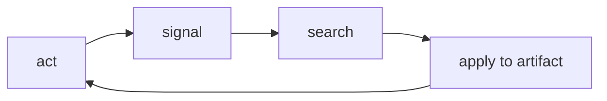

<!-- GENERATED by scripts/generate_skill_pages.py. Do not edit by hand. -->

# signal-card

Name the signal an agent should learn from, in one line ("My agent gets better when ___ goes up"), then lay out the self-improvement loop around it: act, take a signal, search for a better version, apply it. Fills the three choosable slots (signal, search, artifact) with options found in the codebase or the operator's description. Read-only. Link 2 of the SIA audit chain; reads the learning-check envelope. Use after learning-check, when an agent has no signal, or when "I edit the prompt" is the only improvement path.

---

**License:** MIT | **Security:** CLEAN


## Install

```bash
brunnr install signal-card
```


---

## Security Scan

!!! success "CLEAN — 0 findings"
    This skill passed all 7+1 threat class checks with no findings.


---

## File Info

| Property | Value |
|----------|-------|
| **Path** | `skills/signal-card/SKILL.md` |
| **Size** | 6.6 KB |
| **SHA-256** | `f3a476460dd99438a4ccaff4d629bb72c11391e9bd4075c5e3161b88575977d6` |
| **README** | `skills/signal-card/README.md` |

---

## Skill Prompt

### Signal Card

Most agents improve only when a person reads output, judges it, and edits the prompt. That
works until it has to scale, run unattended, or survive an audit. This skill writes down the
signal that would let the agent run that loop itself, and the slots around it.

The loop vocabulary (act → signal → search → apply) follows Micheal Lanham's *Self-Improving
Agents* (Manning).

#### Rules

- **Read-only.** No edits, no agent runs, no model or API calls.
- **The signal comes from outside the model.** It has one of four types, decided by what is
  recorded per output:
  - **score:** a number or pass/fail per output, whether a test computes it or a person's action
    implies it (accepted vs rejected, a thumbs click, reassigned by hand, kept vs rewritten).
  - **preference:** which of two or more outputs for the same input won (A/B, a ranking).
  - **feedback:** words a person wrote about an output ("that date is wrong, use the invoice date").
  - **confidence:** the agent's own estimate, checked against something external.
  Type a signal by its raw form as recorded, not by the number you compute from it: notes a
  reviewer writes are feedback even when you count them.
- **One signal first.** Propose up to three candidates, then recommend one and say why.
- **Cite what exists.** For each slot, prefer options already present in the code (path:line).
  Mark anything new as "to build".
- **Never invent an upstream verdict.** If a field you read is missing, ask for it or reconstruct
  it and list it under `out.reconstructed`.

#### Step 0: Read upstream and place the agent

If a `learning-check` envelope is in context, read `deploymentType`, `verdicts.signal` and
`firstFix`, and reuse its evidence. Otherwise place the agent in one deployment type yourself:

| type | where signals usually are |
|---|---|
| `coding-harness` | PR review outcomes, reverted diffs, CI results |
| `gateway-agent` | corrections in the channel |
| `framework-app` | thumbs, escalations, task outcomes in the app |
| `prompt-program` | labeled examples and existing metric functions |
| `hosted-nocode` | ratings, edits people make before using an output |

#### Step 1: Current loop

Describe how the agent improves today in four nodes: agent runs → who reads the output → who
judges it → what gets edited. If a person fills the middle two, say "you are the loop".

#### Step 2: Candidate signals

List up to three candidates. For each: what is measured, where it would come from, how often it
arrives, what it costs, and its type: **score**, **preference**, **feedback**, or **confidence**.

#### Step 3: The one line

Write: **"My agent gets better when ___ goes up."** The blank names one measurable quantity on a
defined set of examples.

#### Step 4: The slots

| Slot | Options | Pick for now |
|---|---|---|
| Signal | score · preference · feedback · confidence | the recommended candidate's type |
| Search | hill-climbing · demo selection (bootstrap few-shot) · an evolutionary optimizer such as GEPA · person reviewing proposals | the cheapest that fits |
| Artifact | instructions · demos · skill file · memory · code | what the search will change |

#### Output

```markdown
### Signal Card: <agent name>

**Today:** <four-node loop; "you are the loop" if applicable>

**My agent gets better when <quantity> goes up.**

| Candidate | Type | Source | Frequency | Cost |
|---|---|---|---|---|

**Slots:** Signal = … · Search = … · Artifact = …
```

Then the envelope as the last fenced block, then the footer line. The envelope must parse as
YAML: put double quotes around every free-text value (names, `title`, `why`, `do`, each
`evidence` item, claims), because a `: ` or a leading quote inside an unquoted value breaks the
parse. Every key keeps its colon, as in the template (`effort: S`, `impact: medium`); write `medium`,
not `med`.

```yaml
sia:
  skill: signal-card
  version: 1
  agent: { name: "<name>", summary: "<one line>" }
  deploymentType: <type>
  in_ref: learning-check#v1       # or "none"
  out:
    candidates:
      - { quantity: "<what is measured>", type: score, source: "<path:line or system>", frequency: "per release", cost: "free; already recorded" }
    chosenSignal: "<the recommended candidate's quantity>"
    oneLine: "My agent gets better when <quantity> goes up."
    slots: { signal: score, search: "person reviewing proposals", artifact: instructions }
  recommendations:
    - id: sc-1
      effort: S                   # S | M | L
      impact: high                # high | medium | low
      title: "<imperative, one line>"
      why: "<one line tied to evidence>"
      do: "<a step an agent or engineer can do without rereading the report>"
      evidence: ["<path:line>"]   # or "unknown (ask: <question>)"
      next_skill: metric-signature
      links: []
```

> Series and help: peleke.me · LinkedIn

**Recommendations:** at most seven, each with evidence or `unknown (ask: …)`. No pitching.
- Order by what each item unblocks: item 1 is the one the others depend on.
- Size each item (S, M, L) for everything its `do` includes, prerequisites too.
- Each `do` stands alone: no "see above", one named choice rather than an either/or.
- A claim resting on one incident is a hypothesis; say "one case" and what would confirm it. A
  claim that something is absent (no reader, never measured) names where you searched.

#### Gotchas

- "User satisfaction" is not a signal until you say how it's recorded per output.
- A signal that arrives once a quarter can't drive search; pair it with a faster proxy and say so.
- If the honest answer is "when I edit the prompt", that is the finding. Don't dress it up.
- `slots.signal` is the chosen signal's type (score, preference, feedback, confidence), not the
  quantity.

#### Examples

- Release-notes bot: "My agent gets better when the share of bullets the release manager
  publishes unedited goes up." Type: score. Search: person reviews proposed instruction changes.
  Artifact: instructions.
- Changelog summarizer: "…when the share of summary quotes found verbatim in the source goes up."
  Type: score. Search: demo selection (bootstrap few-shot). Artifact: demos.

---

## README

### signal-card

**Complete the sentence: "My agent gets better when ___ goes up."**

Part of the SIA (self-improving agent) audit chain: [learning-check](https://github.com/Peleke/brunnr/blob/main/skills/learning-check) → **signal-card** → [metric-signature](https://github.com/Peleke/brunnr/blob/main/skills/metric-signature) → [field-table](https://github.com/Peleke/brunnr/blob/main/skills/field-table) → [gold-set](https://github.com/Peleke/brunnr/blob/main/skills/gold-set) → [eval-power](https://github.com/Peleke/brunnr/blob/main/skills/eval-power)

#### 1. Quickstart

```bash
brunnr install signal-card
```

Then ask your agent: *"Make a signal card for this agent."* The skill is read-only: it cites a file and line for every finding and makes no model or API calls of its own.

#### 2. Concept

If you can't fill the blank, your agent has no signal, and it can't improve on its own whatever the framework says about memory. If the honest answer is "when something goes wrong and I edit the prompt", you are the loop: you read the output, judge it, and decide what to change.

A self-improving agent runs four steps: act, take a signal, search for something better, apply it. Acting is fixed by the model and harness. The other three are slots you choose: the **signal** (score, preference, feedback, confidence), the **search** (hill-climbing, GEPA, a person reviewing proposals) and the **artifact** it changes (instructions, demos, a skill file, memory, code). Start with the signal.



#### 3. Method

The signal comes first because search has nothing to climb without it. Candidates are typed (score, preference, feedback, confidence) because the type decides which searches can use it: GEPA can read written feedback, while hill-climbing needs a number.

Sources:

- Micheal Lanham, *Self-Improving Agents* (Manning): the act → signal → search → apply loop (vocabulary only; not re-read for this README)
- [DSPy: GEPA overview](https://dspy.ai/api/optimizers/GEPA/overview/): a GEPA metric returns a float or `dspy.Prediction(score=..., feedback=...)`; the feedback text is what GEPA reflects on (`GEPAFeedbackMetric` in `dspy/teleprompt/gepa/gepa.py` returns `Union[float, ScoreWithFeedback]`) (read 2026-11-18)

#### 4. Rubric

| Criterion | Pass condition | Evidence required |
|---|---|---|
| One line | names one measurable quantity on a defined set of examples | where the quantity is recorded |
| Outside the model | the chosen signal isn't the model grading itself | path:line or the operator's quote |
| Candidates | up to three, each with type, source, frequency and cost | path:line per source, or "to build" |
| Slots | signal, search and artifact each filled, preferring what already exists | path:line, or "to build" |

#### 5. Inputs and outputs

**Reads:** `deploymentType`, `verdicts.signal`, `firstFix` from `learning-check`. If no upstream envelope is in context, the skill asks for those fields or reconstructs them from the code and marks them `reconstructed`. It never invents an upstream verdict.

**Writes:** a report a person can read, ending in one `sia:` YAML envelope with `out`: `candidates`, `chosenSignal`, `oneLine`, `slots` (`signal`, `search`, `artifact`). The next skill reads it. The full convention is in [`_sia-chain.md`](https://github.com/Peleke/brunnr/blob/main/skills/_sia-chain.md).

Every run first places the agent in one deployment type, which tells the skill where to look for evidence:

| `deploymentType` | examples |
|---|---|
| `coding-harness` | Claude Code, Codex, Cursor |
| `gateway-agent` | OpenClaw |
| `framework-app` | LangGraph, CrewAI, OpenAI / Claude Agent SDK, Mastra, Google ADK |
| `prompt-program` | DSPy, Ax |
| `hosted-nocode` | custom GPTs, n8n, Copilot Studio |

#### 6. Recommendations

Each report ends with at most seven recommendations, ordered by leverage. Each has `id` (`sc-1`, …), `title`, `why`, `do`, `effort` (S / M / L), `impact` (high / medium / low), `evidence` (paths with line numbers, or `unknown (ask: …)`), `next_skill` and `links`. `do` is written so an agent or an engineer can act on it without rereading the report.

File them as GitHub issues (needs `yq` and `gh`; save the envelope as `report.yaml`):

```bash
yq -o=json '.sia.recommendations[]' report.yaml | jq -c '.' | while read -r r; do gh issue create --title "$(jq -r .title <<<"$r")" --body "$(jq -r '"Why: \(.why)\n\nDo: \(.do)\n\nEffort: \(.effort) · Impact: \(.impact)\nEvidence: \(.evidence|if type=="array" then join(", ") else . end)\nNext: \(.next_skill)"' <<<"$r")"; done
```

#### 7. Run it anywhere

The skill is a plain [Agent Skills](https://agentskills.io/specification) folder: one `SKILL.md` with `name`, `description` and `license`, nothing tool-specific.

| Tool | Where the folder goes |
|---|---|
| brunnr | `brunnr install signal-card` (into `skills/signal-card/`), or `brunnr install signal-card --target <dir>` |
| Claude Code | `.claude/skills/signal-card/` in a project, or `~/.claude/skills/signal-card/` for all projects ([docs](https://code.claude.com/docs/en/skills), read 2026-11-18) |
| Codex | `.agents/skills/signal-card/` in a repo, or `$HOME/.agents/skills/signal-card/` ([docs](https://developers.openai.com/codex/skills), read 2026-11-18) |
| Other tools that read Agent Skills | not verified here; check your tool's docs for its skills directory |

**No skills support?** Paste this as your first message, then describe or attach the agent:

```text
Follow the instructions below exactly. Audit the agent I describe next. Read-only: don't run it.
End with the YAML envelope the instructions specify.

<paste the contents of skills/signal-card/SKILL.md here>
```

#### 8. Next

Next link: [`metric-signature`](https://github.com/Peleke/brunnr/blob/main/skills/metric-signature): write the signal as a metric function.

Series: 02 · Name the signal your agent learns from. The chain's conventions: [`_sia-chain.md`](https://github.com/Peleke/brunnr/blob/main/skills/_sia-chain.md).

Series and help: [peleke.me](https://peleke.me) · LinkedIn

---

*Drafted with AI assistance, edited by me.*
