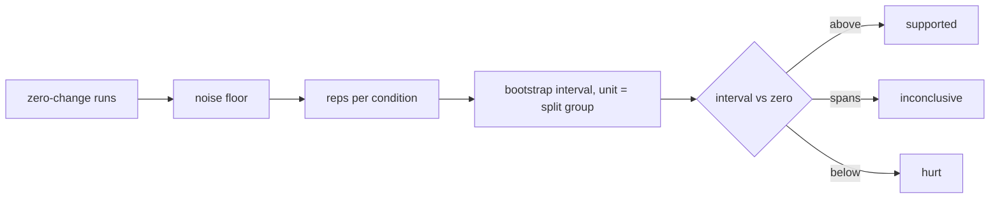

# eval-power

**Your score went from 0.82 to 0.85. Was that the change, or noise?**

Part of the SIA (self-improving agent) audit chain: [learning-check](../learning-check/) → [signal-card](../signal-card/) → [metric-signature](../metric-signature/) → [field-table](../field-table/) → [gold-set](../gold-set/) → **eval-power**

## 1. Quickstart

```bash
brunnr install eval-power
```

Then ask your agent: *"Check whether this agent's eval can detect a real improvement."* The skill is read-only: it cites a file and line for every finding and makes no model or API calls of its own.

## 2. Concept

Run the unchanged system twice and the scores will differ. That spread is the noise floor, and a gain smaller than it is indistinguishable from nothing. This skill plans zero-change runs, repetitions per condition, and a bootstrap interval resampled over the same unit the split groups by, then grades every improvement claim already made as supported, inconclusive or unsupported. An interval that spans zero is a result: the eval can't tell.



## 3. Method

A single run per condition can't separate a change from sampling noise. Resampling at the level the data is grouped keeps the interval honest; resampling individual examples when they come in groups makes it too narrow. Writing the hypothesis, metric, N and model list down before a real-model run keeps the analysis from bending to the result.

Sources:

- Smorodinsky & Kennedy, *Building LLM Applications with DSPy* (Manning), ch. 4 §4.1.2–4.1.3: train / validation / test splits, cross-validation, and "about 30 to 300 examples for each of training and validation, with the bulk of these reserved for validation" (read 2026-11-18)
- A pre-registered comparison in one of our own pipelines: repetitions per condition, a percentile bootstrap over five folds, and a first hypothesis that came back inconclusive (method described; the repo is private)

## 4. Rubric

| Criterion | Pass condition | Evidence required |
|---|---|---|
| Noise floor | zero-change runs measured or planned | the runs, or "never run twice" |
| Interval unit | the bootstrap resamples the unit the split groups by | the split's `groupBy` |
| No overclaim | no claim is stated beyond its interval | the claim's source |
| Pre-registration | recommended for any real-model comparison | the plan |

## 5. Inputs and outputs

**Reads:** `deploymentType`, `split` from `gold-set`; `metrics` from `metric-signature`; any results you paste. If no upstream envelope is in context, the skill asks for those fields or reconstructs them from the code and marks them `reconstructed`. It never invents an upstream verdict.

**Writes:** a report a person can read, ending in one `sia:` YAML envelope with `out`: `reps`, `interval`, `interpretation`, `claimVerdicts`. The next skill reads it. The full convention is in [`_sia-chain.md`](../_sia-chain.md).

Every run first places the agent in one deployment type, which tells the skill where to look for evidence:

| `deploymentType` | examples |
|---|---|
| `coding-harness` | Claude Code, Codex, Cursor |
| `gateway-agent` | OpenClaw |
| `framework-app` | LangGraph, CrewAI, OpenAI / Claude Agent SDK, Mastra, Google ADK |
| `prompt-program` | DSPy, Ax |
| `hosted-nocode` | custom GPTs, n8n, Copilot Studio |

## 6. Recommendations

Each report ends with at most seven recommendations, ordered by leverage. Each has `id` (`ep-1`, …), `title`, `why`, `do`, `effort` (S / M / L), `impact` (high / medium / low), `evidence` (paths with line numbers, or `unknown (ask: …)`), `next_skill` and `links`. `do` is written so an agent or an engineer can act on it without rereading the report.

File them as GitHub issues (needs `yq` and `gh`; save the envelope as `report.yaml`):

```bash
yq -o=json '.sia.recommendations[]' report.yaml | jq -c '.' | while read -r r; do gh issue create --title "$(jq -r .title <<<"$r")" --body "$(jq -r '"Why: \(.why)\n\nDo: \(.do)\n\nEffort: \(.effort) · Impact: \(.impact)\nEvidence: \(.evidence|if type=="array" then join(", ") else . end)\nNext: \(.next_skill)"' <<<"$r")"; done
```

## 7. Run it anywhere

The skill is a plain [Agent Skills](https://agentskills.io/specification) folder: one `SKILL.md` with `name`, `description` and `license`, nothing tool-specific.

| Tool | Where the folder goes |
|---|---|
| brunnr | `brunnr install eval-power` (into `skills/eval-power/`), or `brunnr install eval-power --target <dir>` |
| Claude Code | `.claude/skills/eval-power/` in a project, or `~/.claude/skills/eval-power/` for all projects ([docs](https://code.claude.com/docs/en/skills), read 2026-11-18) |
| Codex | `.agents/skills/eval-power/` in a repo, or `$HOME/.agents/skills/eval-power/` ([docs](https://developers.openai.com/codex/skills), read 2026-11-18) |
| Other tools that read Agent Skills | not verified here; check your tool's docs for its skills directory |

**No skills support?** Paste this as your first message, then describe or attach the agent:

```text
Follow the instructions below exactly. Audit the agent I describe next. Read-only: don't run it.
End with the YAML envelope the instructions specify.

<paste the contents of skills/eval-power/SKILL.md here>
```

## 8. Next

This is the last specified link. A capstone that assembles every envelope into one improvement plan is planned.

Series: B1 · Can your eval tell? (forthcoming). The chain's conventions: [`_sia-chain.md`](../_sia-chain.md).

Series and help: [peleke.me](https://peleke.me) · LinkedIn

---

*Drafted with AI assistance, edited by me.*
