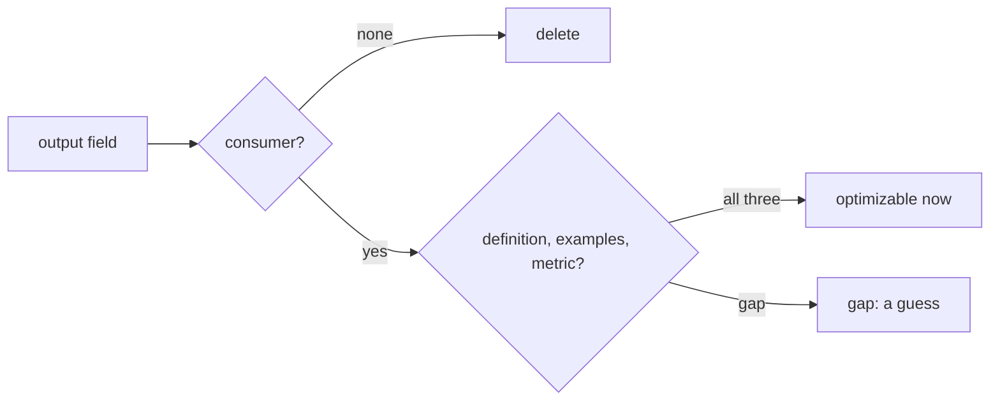

# field-table

**Before any optimizer: who reads each output, and how would you know it's right?**

Part of the SIA (self-improving agent) audit chain: [learning-check](../learning-check/) → [signal-card](../signal-card/) → [metric-signature](../metric-signature/) → **field-table** → [gold-set](../gold-set/) → [eval-power](../eval-power/)

## 1. Quickstart

```bash
brunnr install field-table
```

Then ask your agent: *"Build a field table for this agent's outputs."* The skill is read-only: it cites a file and line for every finding and makes no model or API calls of its own.

## 2. Concept

Every output field gets four columns: its **consumer** (the code or metric that reads it), its **definition** (seen by both the model and the code), its **labeled examples**, and its **metric**. A field with no consumer should be deleted. A field missing any of the other three is a place where an optimizer's "improvement" would be a guess.



## 3. Method

Optimizing one metric invites Goodhart's law, so every field the program emits needs either a reason to exist or a way to be checked. Requiring the definition on both sides catches the common case where the prompt says one thing and the code relies on another.

Sources:

- Smorodinsky & Kennedy, *Building LLM Applications with DSPy* (Manning), ch. 4 §4.2.4: one metric for tuning, several for the final evaluation, and Goodhart's law (read 2026-11-18)
- [Ax: Optimization](https://axllm.dev/typescript/concepts/optimization/): "Normalize scores to `0..1` when possible" and "Use distinct validation examples when selecting a best candidate" (read 2026-11-18)

## 4. Rubric

| Criterion | Pass condition | Evidence required |
|---|---|---|
| Every field | each model output field has a row, including enum values | path:line of the schema or signature |
| Consumer | a reader outside the model call, or "none" | path:line of the read |
| Definition | both the model's text and the code's use, or marked partial | quoted definition |
| Examples and metric | a count of labeled examples and the scoring function, or "to build" | path to the examples and the metric |

## 5. Inputs and outputs

**Reads:** `deploymentType`, `metrics[].outputField` from `metric-signature` (optional side link). If no upstream envelope is in context, the skill asks for those fields or reconstructs them from the code and marks them `reconstructed`. It never invents an upstream verdict.

**Writes:** a report a person can read, ending in one `sia:` YAML envelope with `out`: `fields` (each with `field`, `consumer`, `definition`, `examples`, `metric`). The next skill reads it. The full convention is in [`_sia-chain.md`](../_sia-chain.md).

Every run first places the agent in one deployment type, which tells the skill where to look for evidence:

| `deploymentType` | examples |
|---|---|
| `coding-harness` | Claude Code, Codex, Cursor |
| `gateway-agent` | OpenClaw |
| `framework-app` | LangGraph, CrewAI, OpenAI / Claude Agent SDK, Mastra, Google ADK |
| `prompt-program` | DSPy, Ax |
| `hosted-nocode` | custom GPTs, n8n, Copilot Studio |

## 6. Recommendations

Each report ends with at most seven recommendations, ordered by leverage. Each has `id` (`ft-1`, …), `title`, `why`, `do`, `effort` (S / M / L), `impact` (high / medium / low), `evidence` (paths with line numbers, or `unknown (ask: …)`), `next_skill` and `links`. `do` is written so an agent or an engineer can act on it without rereading the report.

File them as GitHub issues (needs `yq` and `gh`; save the envelope as `report.yaml`):

```bash
yq -o=json '.sia.recommendations[]' report.yaml | jq -c '.' | while read -r r; do gh issue create --title "$(jq -r .title <<<"$r")" --body "$(jq -r '"Why: \(.why)\n\nDo: \(.do)\n\nEffort: \(.effort) · Impact: \(.impact)\nEvidence: \(.evidence|if type=="array" then join(", ") else . end)\nNext: \(.next_skill)"' <<<"$r")"; done
```

## 7. Run it anywhere

The skill is a plain [Agent Skills](https://agentskills.io/specification) folder: one `SKILL.md` with `name`, `description` and `license`, nothing tool-specific.

| Tool | Where the folder goes |
|---|---|
| brunnr | `brunnr install field-table` (into `skills/field-table/`), or `brunnr install field-table --target <dir>` |
| Claude Code | `.claude/skills/field-table/` in a project, or `~/.claude/skills/field-table/` for all projects ([docs](https://code.claude.com/docs/en/skills), read 2026-11-18) |
| Codex | `.agents/skills/field-table/` in a repo, or `$HOME/.agents/skills/field-table/` ([docs](https://developers.openai.com/codex/skills), read 2026-11-18) |
| Other tools that read Agent Skills | not verified here; check your tool's docs for its skills directory |

**No skills support?** Paste this as your first message, then describe or attach the agent:

```text
Follow the instructions below exactly. Audit the agent I describe next. Read-only: don't run it.
End with the YAML envelope the instructions specify.

<paste the contents of skills/field-table/SKILL.md here>
```

## 8. Next

Next link: [`gold-set`](../gold-set/): plan the labeled examples the gaps need.

Series: 03 · The shape of an eval. The chain's conventions: [`_sia-chain.md`](../_sia-chain.md).

Series and help: [peleke.me](https://peleke.me) · LinkedIn

---

*Drafted with AI assistance, edited by me.*
