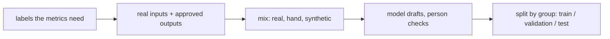

# gold-set

**Your metric needs answers to check against. Plan them before you score anything.**

Part of the SIA (self-improving agent) audit chain: [learning-check](../learning-check/) → [signal-card](../signal-card/) → [metric-signature](../metric-signature/) → [field-table](../field-table/) → **gold-set** → [eval-power](../eval-power/)

## 1. Quickstart

```bash
brunnr install gold-set
```

Then ask your agent: *"Plan a gold set for this agent's metrics."* The skill is read-only: it cites a file and line for every finding and makes no model or API calls of its own.

## 2. Concept

A gold set is the reference input/output pairs a metric runs on, split so the final score means something. This skill plans it: what one example looks like, where real inputs come from, which approved outputs already exist (drafts people edited before sending are labels you already have), who drafts and who checks labels, and a train / validation / test split grouped so near-duplicates don't leak across it.



## 3. Method

Real usage comes first because hand-written and model-made examples tend to be easier than the real thing. Splits are grouped by source because near-duplicates on both sides inflate the score. Size sits in the tens to hundreds: enough to tell candidates apart, small enough to label by hand.

Sources:

- Smorodinsky & Kennedy, *Building LLM Applications with DSPy* (Manning), ch. 4 §4.1.2–4.1.3: train / validation / test splits, cross-validation, and "about 30 to 300 examples for each of training and validation, with the bulk of these reserved for validation" (read 2026-11-18)
- [Ax: Optimization](https://axllm.dev/typescript/concepts/optimization/): "Normalize scores to `0..1` when possible" and "Use distinct validation examples when selecting a best candidate" (read 2026-11-18)

## 4. Rubric

| Criterion | Pass condition | Evidence required |
|---|---|---|
| Real inputs | examples drawn from real usage, with counts per source | the source location |
| Labels defined | every scored field has a label with a written definition | the labeling guide |
| Split before scoring | the split is fixed before any score is looked at | the split plan |
| Grouping | a `groupBy` key keeps near-duplicates on one side | the key and why |
| Size | in the tens-to-hundreds band, counted in groups | the target counts |
| Test once | the test set is scored once, at the end | the plan |

## 5. Inputs and outputs

**Reads:** `deploymentType`, `metrics[].labelsNeeded`, `metrics[].outputField` from `metric-signature`. If no upstream envelope is in context, the skill asks for those fields or reconstructs them from the code and marks them `reconstructed`. It never invents an upstream verdict.

**Writes:** a report a person can read, ending in one `sia:` YAML envelope with `out`: `exampleSchema`, `sources`, `labelingPlan`, `split`, `leakageChecks`. The next skill reads it. The full convention is in [`_sia-chain.md`](../_sia-chain.md).

Every run first places the agent in one deployment type, which tells the skill where to look for evidence:

| `deploymentType` | examples |
|---|---|
| `coding-harness` | Claude Code, Codex, Cursor |
| `gateway-agent` | OpenClaw |
| `framework-app` | LangGraph, CrewAI, OpenAI / Claude Agent SDK, Mastra, Google ADK |
| `prompt-program` | DSPy, Ax |
| `hosted-nocode` | custom GPTs, n8n, Copilot Studio |

## 6. Recommendations

Each report ends with at most seven recommendations, ordered by leverage. Each has `id` (`gs-1`, …), `title`, `why`, `do`, `effort` (S / M / L), `impact` (high / medium / low), `evidence` (paths with line numbers, or `unknown (ask: …)`), `next_skill` and `links`. `do` is written so an agent or an engineer can act on it without rereading the report.

File them as GitHub issues (needs `yq` and `gh`; save the envelope as `report.yaml`):

```bash
yq -o=json '.sia.recommendations[]' report.yaml | jq -c '.' | while read -r r; do gh issue create --title "$(jq -r .title <<<"$r")" --body "$(jq -r '"Why: \(.why)\n\nDo: \(.do)\n\nEffort: \(.effort) · Impact: \(.impact)\nEvidence: \(.evidence|if type=="array" then join(", ") else . end)\nNext: \(.next_skill)"' <<<"$r")"; done
```

## 7. Run it anywhere

The skill is a plain [Agent Skills](https://agentskills.io/specification) folder: one `SKILL.md` with `name`, `description` and `license`, nothing tool-specific.

| Tool | Where the folder goes |
|---|---|
| brunnr | `brunnr install gold-set` (into `skills/gold-set/`), or `brunnr install gold-set --target <dir>` |
| Claude Code | `.claude/skills/gold-set/` in a project, or `~/.claude/skills/gold-set/` for all projects ([docs](https://code.claude.com/docs/en/skills), read 2026-11-18) |
| Codex | `.agents/skills/gold-set/` in a repo, or `$HOME/.agents/skills/gold-set/` ([docs](https://developers.openai.com/codex/skills), read 2026-11-18) |
| Other tools that read Agent Skills | not verified here; check your tool's docs for its skills directory |

**No skills support?** Paste this as your first message, then describe or attach the agent:

```text
Follow the instructions below exactly. Audit the agent I describe next. Read-only: don't run it.
End with the YAML envelope the instructions specify.

<paste the contents of skills/gold-set/SKILL.md here>
```

## 8. Next

Next link: [`eval-power`](../eval-power/): check whether this eval can detect the change you care about.

Series: B0 · Gold sets (forthcoming). The chain's conventions: [`_sia-chain.md`](../_sia-chain.md).

Series and help: [peleke.me](https://peleke.me) · LinkedIn

---

*Drafted with AI assistance, edited by me.*
