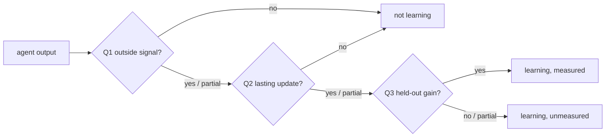

# learning-check

**Does your agent learn, or do you? Three questions, answered with evidence.**

Part of the SIA (self-improving agent) audit chain: **learning-check** → [signal-card](../signal-card/) → [metric-signature](../metric-signature/) → [field-table](../field-table/) → [gold-set](../gold-set/) → [eval-power](../eval-power/)

## 1. Quickstart

```bash
brunnr install learning-check
```

Then ask your agent: *"Run a learning check on this repo."* The skill is read-only: it cites a file and line for every finding and makes no model or API calls of its own.

## 2. Concept

Take one agent you run and answer three questions about each of its loops:

1. **When it gets something wrong, what tells it?** Something outside the model: a test, a review, a user.
2. **When that happens, what changes, and by how much?**
3. **Is it measurably better over time,** on examples it didn't train on?

If the answer to the first two is "I fix the prompt", the learning is happening in you, not in the agent. Most "learning" features are memory: the model writes notes and reads them back, and nothing records how much any note changed.



## 3. Method

Each question removes one way an agent can look like it learns without learning: a signal the model makes up about itself (Q1), a change nobody can measure or that a person applies by hand (Q2), and a score on the same examples the change was tuned on (Q3). The outcome rule is a pure function; `brunnr.sia_chain.learning_outcome` implements it and a test checks all 54 combinations.

Sources:

- [Learning Is Not Memory](https://peleke.me/writing/learning-is-not-memory) (2026-03-09): the longer argument for the three questions
- Smorodinsky & Kennedy, *Building LLM Applications with DSPy* (Manning), ch. 4 §4.2.4: one metric for tuning, several for the final evaluation, and Goodhart's law (read 2026-11-18)
- [Ax: Optimization](https://axllm.dev/typescript/concepts/optimization/): "Normalize scores to `0..1` when possible" and "Use distinct validation examples when selecting a best candidate" (read 2026-11-18)

## 4. Rubric

| Criterion | Pass condition | Evidence required |
|---|---|---|
| Q1 outside signal | a signal the model can't make by reviewing itself reaches the agent without a person carrying it | path:line of where the outcome is recorded, or the operator's quote |
| Q2 lasting update | a change survives across runs, applied without a person, recorded in a unit you can diff | path:line of the code that applies it |
| Q3 measured gain | a held-out score compared with a baseline, recorded more than once | dated result files or CI output |
| Outcome | follows the rule from Q1–Q3 and whether one person carries and applies | the three verdicts |

## 5. Inputs and outputs

**Reads:** nothing (first link). Point it at a repo, a service, or a written description.. If no upstream envelope is in context, the skill asks for those fields or reconstructs them from the code and marks them `reconstructed`. It never invents an upstream verdict.

**Writes:** a report a person can read, ending in one `sia:` YAML envelope with `out`: `verdicts` (the headline loop's Q1–Q3), `loops`, `outcome`, `firstFix`. The next skill reads it. The full convention is in [`_sia-chain.md`](../_sia-chain.md).

Every run first places the agent in one deployment type, which tells the skill where to look for evidence:

| `deploymentType` | examples |
|---|---|
| `coding-harness` | Claude Code, Codex, Cursor |
| `gateway-agent` | OpenClaw |
| `framework-app` | LangGraph, CrewAI, OpenAI / Claude Agent SDK, Mastra, Google ADK |
| `prompt-program` | DSPy, Ax |
| `hosted-nocode` | custom GPTs, n8n, Copilot Studio |

## 6. Recommendations

Each report ends with at most seven recommendations, ordered by leverage. Each has `id` (`lc-1`, …), `title`, `why`, `do`, `effort` (S / M / L), `impact` (high / medium / low), `evidence` (paths with line numbers, or `unknown (ask: …)`), `next_skill` and `links`. `do` is written so an agent or an engineer can act on it without rereading the report.

File them as GitHub issues (needs `yq` and `gh`; save the envelope as `report.yaml`):

```bash
yq -o=json '.sia.recommendations[]' report.yaml | jq -c '.' | while read -r r; do gh issue create --title "$(jq -r .title <<<"$r")" --body "$(jq -r '"Why: \(.why)\n\nDo: \(.do)\n\nEffort: \(.effort) · Impact: \(.impact)\nEvidence: \(.evidence|join(", "))\nNext: \(.next_skill)"' <<<"$r")"; done
```

## 7. Run it anywhere

The skill is a plain [Agent Skills](https://agentskills.io/specification) folder: one `SKILL.md` with `name`, `description` and `license`, nothing tool-specific.

| Tool | Where the folder goes |
|---|---|
| brunnr | `brunnr install learning-check` (into `skills/learning-check/`), or `brunnr install learning-check --target <dir>` |
| Claude Code | `.claude/skills/learning-check/` in a project, or `~/.claude/skills/learning-check/` for all projects ([docs](https://code.claude.com/docs/en/skills), read 2026-11-18) |
| Codex | `.agents/skills/learning-check/` in a repo, or `$HOME/.agents/skills/learning-check/` ([docs](https://developers.openai.com/codex/skills), read 2026-11-18) |
| Other tools that read Agent Skills | not verified here; check your tool's docs for its skills directory |

**No skills support?** Paste this as your first message, then describe or attach the agent:

```text
Follow the instructions below exactly. Audit the agent I describe next. Read-only: don't run it.
End with the YAML envelope the instructions specify.

<paste the contents of skills/learning-check/SKILL.md here>
```

## 8. Next

Next link: [`signal-card`](../signal-card/): name the signal your agent should learn from.

Series: 01 · Does your agent learn?. The chain's conventions: [`_sia-chain.md`](../_sia-chain.md).

Series and help: [peleke.me](https://peleke.me) · LinkedIn

---

*Drafted with AI assistance, edited by me.*
