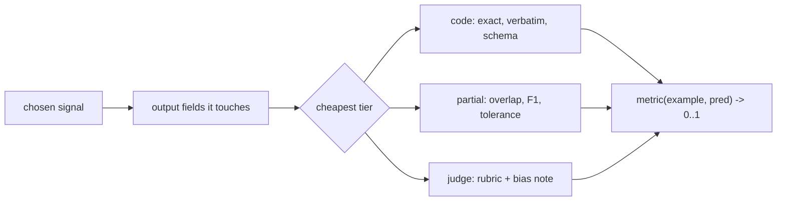

# metric-signature

**A signal becomes a metric once you write it as a function.**

Part of the SIA (self-improving agent) audit chain: [learning-check](../learning-check/) → [signal-card](../signal-card/) → **metric-signature** → [field-table](../field-table/) → [gold-set](../gold-set/) → [eval-power](../eval-power/)

## 1. Quickstart

```bash
brunnr install metric-signature
```

Then ask your agent: *"Write the metric signature for this agent's signal."* The skill is read-only: it cites a file and line for every finding and makes no model or API calls of its own.

## 2. Concept

An optimizer climbs whatever the metric measures, so the metric holds the signal. "My agent gets better when ___ goes up" becomes `metric(example, prediction) -> float`.

This skill picks the cheapest check that can tell a good output from a bad one (exact match before partial credit, and partial credit before an LLM judge), writes it as a Python and a TypeScript signature plus one plain sentence, normalizes it to 0..1, and names what a do-nothing version scores. Without that baseline, no gain can be claimed.



## 3. Method

Cheaper tiers come first because they're deterministic and free to run thousands of times; a judge adds cost, variance and its own biases. Scores are normalized to 0..1 so metrics can be compared and combined. The signature follows the shapes the two main prompt-optimization libraries accept, so it drops into either.

Sources:

- [DSPy: Metrics](https://dspy.ai/learn/evaluation/metrics/): a metric takes `example` and `pred` and returns a `float`, `int` or `bool`; the optional `trace` argument switches it to bootstrapping mode (read 2026-11-18)
- [DSPy: GEPA overview](https://dspy.ai/api/optimizers/GEPA/overview/): GEPA expects the metric to return `dspy.Prediction(score=..., feedback=...)` (read 2026-11-18)
- [Ax: Optimization](https://axllm.dev/typescript/concepts/optimization/): "Normalize scores to `0..1` when possible" and "Use distinct validation examples when selecting a best candidate" (read 2026-11-18)
- [Ax source, `AxMetricFn`](https://github.com/ax-llm/ax/blob/main/src/ax/dsp/common_types.ts): `({ prediction, example }) => number` (read 2026-11-18)

## 4. Rubric

| Criterion | Pass condition | Evidence required |
|---|---|---|
| Maps to the signal | every metric scores a field the chosen signal touches | the signal-card envelope, or the operator's quote |
| Cheapest tier | code before partial before judge, with the reason for any judge | the field's definition, path:line |
| Range | 0..1, higher is better | the signature |
| Labels | the reference values each metric needs are named | where they would come from |
| Baseline | a do-nothing version and its expected score | the majority label or current output |
| Judge rubric | judge-tier metrics have a written rubric and a bias note | the rubric text |

## 5. Inputs and outputs

**Reads:** `deploymentType`, `chosenSignal`, `slots.artifact` from `signal-card`. If no upstream envelope is in context, the skill asks for those fields or reconstructs them from the code and marks them `reconstructed`. It never invents an upstream verdict.

**Writes:** a report a person can read, ending in one `sia:` YAML envelope with `out`: `metrics` (each with `outputField`, `tier`, `range`, `feedbackText`, `labelsNeeded`, `signature`), `baseline`, `fieldsUnscored`. The next skill reads it. The full convention is in [`_sia-chain.md`](../_sia-chain.md).

Every run first places the agent in one deployment type, which tells the skill where to look for evidence:

| `deploymentType` | examples |
|---|---|
| `coding-harness` | Claude Code, Codex, Cursor |
| `gateway-agent` | OpenClaw |
| `framework-app` | LangGraph, CrewAI, OpenAI / Claude Agent SDK, Mastra, Google ADK |
| `prompt-program` | DSPy, Ax |
| `hosted-nocode` | custom GPTs, n8n, Copilot Studio |

## 6. Recommendations

Each report ends with at most seven recommendations, ordered by leverage. Each has `id` (`ms-1`, …), `title`, `why`, `do`, `effort` (S / M / L), `impact` (high / medium / low), `evidence` (paths with line numbers, or `unknown (ask: …)`), `next_skill` and `links`. `do` is written so an agent or an engineer can act on it without rereading the report.

File them as GitHub issues (needs `yq` and `gh`; save the envelope as `report.yaml`):

```bash
yq -o=json '.sia.recommendations[]' report.yaml | jq -c '.' | while read -r r; do gh issue create --title "$(jq -r .title <<<"$r")" --body "$(jq -r '"Why: \(.why)\n\nDo: \(.do)\n\nEffort: \(.effort) · Impact: \(.impact)\nEvidence: \(.evidence|join(", "))\nNext: \(.next_skill)"' <<<"$r")"; done
```

## 7. Run it anywhere

The skill is a plain [Agent Skills](https://agentskills.io/specification) folder: one `SKILL.md` with `name`, `description` and `license`, nothing tool-specific.

| Tool | Where the folder goes |
|---|---|
| brunnr | `brunnr install metric-signature` (into `skills/metric-signature/`), or `brunnr install metric-signature --target <dir>` |
| Claude Code | `.claude/skills/metric-signature/` in a project, or `~/.claude/skills/metric-signature/` for all projects ([docs](https://code.claude.com/docs/en/skills), read 2026-11-18) |
| Codex | `.agents/skills/metric-signature/` in a repo, or `$HOME/.agents/skills/metric-signature/` ([docs](https://developers.openai.com/codex/skills), read 2026-11-18) |
| Other tools that read Agent Skills | not verified here; check your tool's docs for its skills directory |

**No skills support?** Paste this as your first message, then describe or attach the agent:

```text
Follow the instructions below exactly. Audit the agent I describe next. Read-only: don't run it.
End with the YAML envelope the instructions specify.

<paste the contents of skills/metric-signature/SKILL.md here>
```

## 8. Next

Next link: [`gold-set`](../gold-set/): plan the reference set the metric runs on (or `field-table` first, to audit every output field).

Series: 03 · The shape of an eval. The chain's conventions: [`_sia-chain.md`](../_sia-chain.md).

Series and help: [peleke.me](https://peleke.me) · LinkedIn

---

*Drafted with AI assistance, edited by me.*
