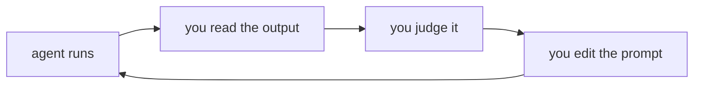
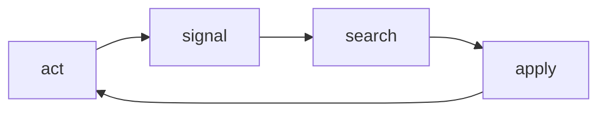

# Signal Card

**Name the signal your agent learns from.**

Write one line:

> My agent gets better when ___ goes up.

If you can't fill in the blank, your agent has no signal. It can't improve on its own, whatever its memory feature is called.

## You are probably the loop

If the honest answer is "when I notice something wrong and edit the prompt", then you are the improvement loop. You read the output, judge it, decide what to change, and rerun. That works...until it has to scale, run while you sleep, or survive an audit.



## The loop with the steps named

Micheal Lanham's *Self-Improving Agents* (Manning) describes a self-improving agent as a loop with four steps: act, take a signal, search for a better version, apply it. Three of them are slots you choose:

| Slot | Options |
|---|---|
| Signal | a score, a preference between two outputs, written feedback, a confidence value |
| Search | hill-climbing, an evolutionary optimizer such as GEPA, a person reviewing proposals |
| Artifact | what gets changed: a prompt, demos, a skill file, a memory, code |



The work is the same as in the first diagram. The difference is that every step is named, so you can replace it.

Start with the signal. Until it exists, search has nothing to climb.

## Run it with an agent

```bash
brunnr install signal-card
```

Ask: *"Make a signal card for this agent."* It proposes up to three candidate signals from what's already in the code, recommends one, fills the three slots, and marks anything that doesn't exist yet as "to build". Read-only.

## Next

Write the signal as a metric function, `metric(example, prediction) -> float`, then run [`field-table`](../field-table/) on every output it touches.

---

*Part of the SIA (self-improving agents) series. Drafted with AI assistance, edited by me.*
