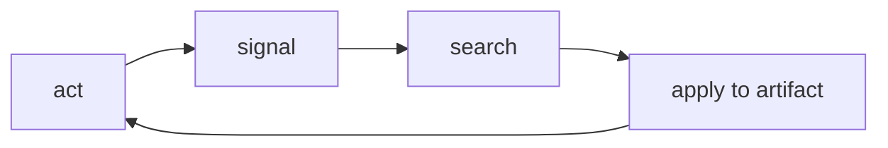

# signal-card

**Complete the sentence: "My agent gets better when ___ goes up."**

Part of the SIA (self-improving agent) audit chain: [learning-check](../learning-check/) → **signal-card** → [metric-signature](../metric-signature/) → [field-table](../field-table/) → [gold-set](../gold-set/) → [eval-power](../eval-power/)

## 1. Quickstart

```bash
brunnr install signal-card
```

Then ask your agent: *"Make a signal card for this agent."* The skill is read-only: it cites a file and line for every finding and makes no model or API calls of its own.

## 2. Concept

If you can't fill the blank, your agent has no signal, and it can't improve on its own whatever the framework says about memory. If the honest answer is "when something goes wrong and I edit the prompt", you are the loop: you read the output, judge it, and decide what to change.

A self-improving agent runs four steps: act, take a signal, search for something better, apply it. Acting is fixed by the model and harness. The other three are slots you choose: the **signal** (score, preference, feedback, confidence), the **search** (hill-climbing, GEPA, a person reviewing proposals) and the **artifact** it changes (instructions, demos, a skill file, memory, code). Start with the signal.



## 3. Method

The signal comes first because search has nothing to climb without it. Candidates are typed (score, preference, feedback, confidence) because the type decides which searches can use it: GEPA can read written feedback, while hill-climbing needs a number.

Sources:

- Micheal Lanham, *Self-Improving Agents* (Manning): the act → signal → search → apply loop (vocabulary only; not re-read for this README)
- [DSPy: GEPA overview](https://dspy.ai/api/optimizers/GEPA/overview/): GEPA expects the metric to return `dspy.Prediction(score=..., feedback=...)` (read 2026-11-18)

## 4. Rubric

| Criterion | Pass condition | Evidence required |
|---|---|---|
| One line | names one measurable quantity on a defined set of examples | where the quantity is recorded |
| Outside the model | the chosen signal isn't the model grading itself | path:line or the operator's quote |
| Candidates | up to three, each with type, source, frequency and cost | path:line per source, or "to build" |
| Slots | signal, search and artifact each filled, preferring what already exists | path:line, or "to build" |

## 5. Inputs and outputs

**Reads:** `deploymentType`, `verdicts.signal`, `firstFix` from `learning-check`. If no upstream envelope is in context, the skill asks for those fields or reconstructs them from the code and marks them `reconstructed`. It never invents an upstream verdict.

**Writes:** a report a person can read, ending in one `sia:` YAML envelope with `out`: `candidates`, `chosenSignal`, `oneLine`, `slots` (`signal`, `search`, `artifact`). The next skill reads it. The full convention is in [`_sia-chain.md`](../_sia-chain.md).

Every run first places the agent in one deployment type, which tells the skill where to look for evidence:

| `deploymentType` | examples |
|---|---|
| `coding-harness` | Claude Code, Codex, Cursor |
| `gateway-agent` | OpenClaw |
| `framework-app` | LangGraph, CrewAI, OpenAI / Claude Agent SDK, Mastra, Google ADK |
| `prompt-program` | DSPy, Ax |
| `hosted-nocode` | custom GPTs, n8n, Copilot Studio |

## 6. Recommendations

Each report ends with at most seven recommendations, ordered by leverage. Each has `id` (`sc-1`, …), `title`, `why`, `do`, `effort` (S / M / L), `impact` (high / medium / low), `evidence` (paths with line numbers, or `unknown (ask: …)`), `next_skill` and `links`. `do` is written so an agent or an engineer can act on it without rereading the report.

File them as GitHub issues (needs `yq` and `gh`; save the envelope as `report.yaml`):

```bash
yq -o=json '.sia.recommendations[]' report.yaml | jq -c '.' | while read -r r; do gh issue create --title "$(jq -r .title <<<"$r")" --body "$(jq -r '"Why: \(.why)\n\nDo: \(.do)\n\nEffort: \(.effort) · Impact: \(.impact)\nEvidence: \(.evidence|join(", "))\nNext: \(.next_skill)"' <<<"$r")"; done
```

## 7. Run it anywhere

The skill is a plain [Agent Skills](https://agentskills.io/specification) folder: one `SKILL.md` with `name`, `description` and `license`, nothing tool-specific.

| Tool | Where the folder goes |
|---|---|
| brunnr | `brunnr install signal-card` (into `skills/signal-card/`), or `brunnr install signal-card --target <dir>` |
| Claude Code | `.claude/skills/signal-card/` in a project, or `~/.claude/skills/signal-card/` for all projects ([docs](https://code.claude.com/docs/en/skills), read 2026-11-18) |
| Codex | `.agents/skills/signal-card/` in a repo, or `$HOME/.agents/skills/signal-card/` ([docs](https://developers.openai.com/codex/skills), read 2026-11-18) |
| Other tools that read Agent Skills | not verified here; check your tool's docs for its skills directory |

**No skills support?** Paste this as your first message, then describe or attach the agent:

```text
Follow the instructions below exactly. Audit the agent I describe next. Read-only: don't run it.
End with the YAML envelope the instructions specify.

<paste the contents of skills/signal-card/SKILL.md here>
```

## 8. Next

Next link: [`metric-signature`](../metric-signature/): write the signal as a metric function.

Series: 02 · Name the signal your agent learns from. The chain's conventions: [`_sia-chain.md`](../_sia-chain.md).

Series and help: [peleke.me](https://peleke.me) · LinkedIn

---

*Drafted with AI assistance, edited by me.*
